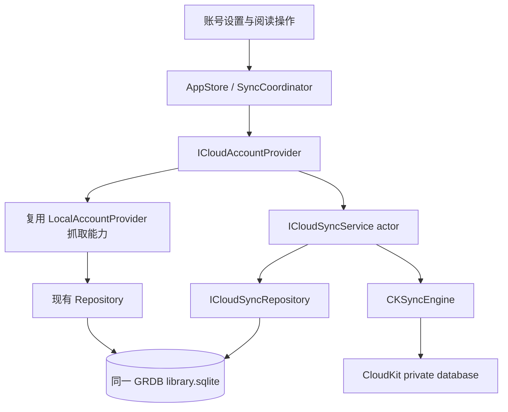

# iCloud 同步实施方案

> 设计日期：2026-10-01。范围：现有 macOS 14+、Swift 6、GRDB、AccountProvider 架构。
> 状态：macOS 优先，P1–P3 的同步、账号／设置、RSS 正文和保守复制路径已实现；P4 已有自动同步、推送、重试、统计、恢复／只读归档和物理代次隔离。清理已接通共享配额、持久化有限任务、条件删除 SDK、独立时间校验确认、审阅／停止／进度页面和 Provider 生命周期；按页发现不依赖全库统计完成。2026-10-05 补齐默认关闭的持续维护授权、后续有限批次发现及原请求结果的只读复核。另有保留旧云资料、准备空的新代次的审阅入口，归档接入及具体复制仍分别确认。普通建库默认 v2，清理与升级默认不启用。2026-10-08 完成 macOS Development 签名、指定容器权限及共享运行方案，见第 13 节。双 Mac／真实 SDK、页面交互、无法确认结果的任务结束规则及最终历史兼容／隐私验收留给维护者。本轮没有启动正式 App、读写实际云端阅读资料或执行正式资料处置。阶段证据见第 9 节，目标行为不代表已经上线。

## 1. 结论与现状

采用 **CloudKit 私有数据库 + CKSyncEngine + 现有 GRDB**。增加独立 iCloud 账号，复用本地 RSS 抓取、解析、正文和阅读投影；订阅、目录、已读和收藏双向同步，收藏正文始终同步，未读正文默认不同步且可开启。保持 Mac 本地账号、FreshRSS、Miniflux 的资料和凭据边界。

不将 SQLite 放进 iCloud Drive，不迁移到 Core Data/SwiftData，不引入第三方同步框架。CKSyncEngine 在 macOS 14 已可用，负责网络调度、系统触发和重试；应用仍负责持久化、变更捕获、身份、冲突及删除语义。[Apple CKSyncEngine](https://developer.apple.com/documentation/cloudkit/cksyncengine-5sie5)、[WWDC23 说明](https://developer.apple.com/videos/play/wwdc2023/10188/)。

2026-10-01 实施前的架构评估如下；表中“必须补齐”描述初始缺口，已完成部分及当前剩余项以第 9 节和第 12.7 节为准：

| 入口 | 已有能力 | 必须补齐 |
| --- | --- | --- |
| `Account/Account.swift`、`SyncCoordinator.swift` | local / freshRSS / miniflux、Provider 注册及刷新 | iCloud 类型；区分“服务器抓文章”和“直接抓 RSS、CloudKit 同步” |
| `Account/LocalAccountProvider.swift` | 可传 accountID，抓取、OPML、订阅管理 | 初始评估时 AppStore 部分路径固定 local-default、OPML 仅导入 URL；P3 后端路由及标题／目录保留的当前证据见第 9 节 |
| `Persistence/Repositories/ArticleStateRepository.swift` | 远端状态与 outbox 同事务写入；revision 防止迟到确认 | 本地抓取型账号的 CloudKit 变更队列 |
| `Persistence/Repositories/ArticleRepository.swift` | 本地 Item ID = digest(feed UUID + parsed.id) | 持久化源条目 ID；云端 ID 不依赖每台 Mac 的 UUID |
| `Persistence/DatabaseMigrations.swift` | GRDB 版本迁移、外键、单一 library.sqlite | 同步日志、engine checkpoint、身份兼容迁移 |
| `CloudSyncService.swift` | entitlement 防崩溃检查；单个 CKAsset 全库合并原型 | 原型没有并发保护、目录、持久化变更队列、删除及增量语义，不能作为正式实现 |
| `AppStore.syncICloud()` | 空实现 | 真正的刷新、自动同步、状态和失败反馈 |
| `SettingsView.swift` | 本地及两个服务器账号 | iCloud 添加入口、状态、正文策略与维护功能 |
| entitlements template / Xcode 工程 | 有 CloudKit 模板，未接入正式 capability | 有效开发者签名、container、推送与开发/生产环境配置 |

旧全库原型的 AIArtifact 载荷不沿用。新的同步编码器使用明确的字段白名单，不接收 AppDatabase、AISettings、凭据或任意配置对象。

## 2. NetNewsWire 对标依据

已阅读 workspace `area/NetNewsWire-main`：macOS 配置版本 `7.1.3b4`，最低 macOS 15。它的系统最低版本不成为 PaperRss 提高最低版本的理由。

源码快照定位（用于复查，不声称等于 GitHub 今日 HEAD）：

- `CloudKitAccountDelegate.swift` SHA-256：`e7bb0e1a113e17aab1677cd5bb8b31e5a825a126dbb0445d2ccc052867f670d5`。
- `CloudKitArticlesZone.swift` SHA-256：`1b8ed60313d5c7e49b28d490a44207420321b348caf24026bd21dff1b22be334`。
- 许可证：MIT。本实现采用其产品行为和可靠性思路，独立编写代码；若后续直接移植代码，保留对应许可证及版权说明。

| 体验 | NetNewsWire 已核实行为 / 依据 | PaperRss 最终行为 |
| --- | --- | --- |
| 账号 | 独立 cloudKit 账号，最多一个；Mac 添加时检查系统 iCloud 状态 | 独立 iCloud 账号，最多一个；通过 CKContainer.accountStatus 判定，不把 iCloud Drive 文件权限当作 CloudKit 的必要条件 |
| 订阅和目录 | Account zone；订阅、重命名、移动、OPML 生命周期操作 | Library zone；离线操作先本地提交，待发送队列跟进 |
| 已读 / 收藏 | Articles zone；接收时分别排除本地 pending read / starred，防止覆盖待发送意图 | 分字段日志及冲突保护；批量已读同事务捕获，读和收藏互不覆盖 |
| 收藏正文 | 上传收藏的 RSS 正文与条目元信息 | 始终同步；新 Mac 能恢复 RSS 已移除的收藏条目 |
| 未读正文 | 可开关；官方帮助说明新用户默认关闭、老用户保留原设置 | 新账号默认关闭；开启后同步未读正文，设置在 iCloud 账号内同步 |
| 刷新顺序 | 拉订阅 → 拉状态 → 抓 RSS → 发状态；iCloud 失败仍抓 RSS | 同样保持离线阅读与 RSS 刷新可用；云端失败不会显示成同步成功 |
| 手动 / 自动 | 立即刷新、状态发送、远程通知、系统账号变化 | 手动刷新 + CKSyncEngine 自动调度；恢复前台、网络恢复、账号变化补同步 |
| 删除 | zone changes 传播删除，正文可跟随状态删除 | 持久化墓碑、删除优先和代次校验；不因旧设备补发而复活订阅 |
| 历史 / 空间 | 状态与正文分离；183 天过期状态；分批清理、统计窗口 | 已确认首版保留 183 天，每周最多处理 400 条；收藏和 pending 不过期；执行仍须通过并发保护及真实云端验收 |
| 诊断 | 页 / 批日志、状态 / 内容统计、清理反馈 | 上次成功时间、阶段、待发送数量、可操作错误；日志仅计数、错误码与耗时 |
| 移除账号 | 账号与远端资料独立 | 暂停保留数据；移除仅删除当前 Mac 的该账号；删除云端资料是单独确认操作 |

源码依据：[AccountDelegate](https://github.com/Ranchero-Software/NetNewsWire/blob/main/Modules/Account/Sources/Account/CloudKit/CloudKitAccountDelegate.swift)、[ArticlesZone](https://github.com/Ranchero-Software/NetNewsWire/blob/main/Modules/Account/Sources/Account/CloudKit/CloudKitArticlesZone.swift)、[接收状态](https://github.com/Ranchero-Software/NetNewsWire/blob/main/Modules/Account/Sources/Account/CloudKit/CloudKitArticlesZoneDelegate.swift)、[发送队列](https://github.com/Ranchero-Software/NetNewsWire/blob/main/Modules/Account/Sources/Account/CloudKit/CloudKitSendStatusOperation.swift)。正文策略和清理体验见 [NetNewsWire 官方帮助](https://netnewswire.com/help/optimize-icloud.html)。

## 3. 用户流程与范围

1. 设置 → 账号 → 添加 iCloud；复用系统 Apple Account，不索取密码。
2. 新 Mac 先拉取远端账号根、订阅和目录，展示“正在恢复”；然后抓 RSS，并恢复收藏正文。恢复期间可以阅读已经落库的内容。
3. 现有本地资料不自动迁走。添加账号时提供“使用云端订阅”与“复制本地订阅及阅读状态到 iCloud”；复制保持原资料，映射身份并去重，不只导入 OPML 导致状态丢失。
4. iCloud 账号在侧栏及账号设置单独显示；添加订阅、目录、OPML 导入必须明确当前目标账号。相同 URL 在本地与 iCloud 可以各有一份，不跨账号折叠。
5. 每次阅读、收藏、批量已读、重命名、移动和删除立即在本地生效。窗口关闭、网络失败、进程退出都不能清空待发送操作。
6. 账号暂停只停止网络同步和定时抓取，仍保留变更记录；恢复时先拉云端再重放本地待发送意图。
7. “同步未读正文”默认关闭；说明关闭后新设备可能缺少已从 RSS 消失的未读文章，已读和收藏状态仍同步。
8. 区分：RSS 刷新完成、当前同步批次完成、仍有待发送项；仅当完整拉取及发送轮次成功且无待发送项时更新成功时间。

首版不增加 iOS、Windows、网页客户端、多人共享、阅读位置同步、AI 结果 / 模型配置 / API Key 同步。AI 产物、正文提取缓存、图片缓存、ETag、Last-Modified、阅读器外观及翻译名单继续保留在本地。同步 RSS 正文时不自动触发 AI 或额外全文提取。

## 4. 架构与数据契约



- Core 不依赖 SwiftUI/AppKit。系统推送入口和应用生命周期放 App；解析、同步状态和持久化放 Core。
- 新增 `AccountType.iCloud`；增加“直接抓 RSS / 服务器抓文章 / 状态发送方式”的策略属性，不能简单用 `type != local` 把 iCloud 路由给 Google Reader。
- iCloud Provider 遵循现有 AccountProvider。SyncCoordinator 的循环按 Provider 能力路由，移除 `accountID != local-default` 等隐含假设。
- 一名系统 iCloud 用户对应一个 PaperRss 私有账号根；每台设备的本地 accountID 与远端 rootID 明确映射，不使用端点或系统邮箱充当身份。
- 两个自定义 zone：`PaperRssLibrary-v1`（账号设置、Feed、Folder、Membership、墓碑）和 `PaperRssArticles-v1`（文章字段状态、可选正文）。同一个 private database 使用一个 CKSyncEngine，按 zone/阶段恢复并持久化数据库级 engine state；跨 zone 无原子事务，正文必须能容忍订阅稍后到达。

### 4.1 稳定身份

| 对象 | 云端身份 | 兼容方法 |
| --- | --- | --- |
| Feed | `feed-v1:` + SHA-256(带 UTF-8 字节长度前缀的规范化 RSS URL) | 保留本地 UUID；仅去 fragment、大小写规范 scheme/host、移除默认端口；保留路径、尾斜杠、query 顺序和 http/https 差别 |
| Folder | 生成一次的云端 UUID，重命名不改变 | P2 增加映射；现有按名字生成的本地 ID 可换，但重命名事务必须迁移映射 |
| Membership | SHA-256(云端 Feed ID、云端 Folder ID 的带长度编码) | 每条关系单独同步；移动由关系增删组成 |
| Article | `article-v1:` + SHA-256(Feed identity、原始源条目 ID 的带长度编码) | 新增 items.source_item_id；本地 Item ID、AI/cache 外键不重写 |
| 状态 | article identity + `read` 或 `starred` | 字段独立版本和待发送意图，避免整体 ReadingState 覆盖 |

不能把当前 String.stableDigest 当云端 SHA-256（它是 FNV-1a 64 bit）；新增独立身份工具。不同 Feed 的同一 GUID 不合并；同 Feed 的不同 GUID 即使 URL 相同也不合并。

旧数据没有原始 GUID，不能从 FNV hash 反推。正常再次解析同一条目时，利用已有 itemID 找到旧记录，回填 source_item_id，不新增重复条目、不修改已读状态。维护者于 2026-10-02 确认首版采用保守复制规则：尚未回填的历史收藏继续留在源本地库，不引入 URL 身份桥接；以后如扩展历史兼容方式，另行设计碰撞处理并验收。不猜标题，不谎报全部历史资料可同步。没有可靠 GUID / Atom ID / JSON ID / link 的条目保留本地阅读，但暂不产生云端文章身份。

### 4.2 云端记录白名单

| recordType | 字段 / 规则 |
| --- | --- |
| AccountRoot / AccountPreference | schemaVersion、rootID、generation、syncUnreadContent |
| Feed | identity、feedURL、显示名称、siteURL、sortOrder、字段版本、deleted、generation |
| Folder | identity、name、sortOrder、字段版本、deleted、generation |
| Membership | feedIdentity、folderIdentity、present、版本、generation |
| ArticleRead / ArticleStarred | articleIdentity、feedIdentity、sourceItemID、value、字段版本、generation |
| ArticleContent | articleIdentity、feedIdentity、sourceItemID、title、author、URL、publishedAt、summary、RSS contentHTML、contentVersion、generation |
| ArticleRetention（仅 v3 writer） | retention-v1:文章散列、feedRecordName 散列、三个 floor 各自是否已设置及版本，以及每次条件保存新生成的 writer_nonce；代次由物理区和 record ID 核验，不带原始 GUID、URL 或正文 |
| ArticleRetentionPolicy（仅 v3 writer） | 固定 articles 策略身份、protect_unread／release_unread 的独立单调版本，以及每次条件保存的新 writer_nonce；保护先于 library 开启，释放后于 library 关闭的服务器确认 |
| ArticleRetentionQuota（仅 v3 writer） | 固定 articles 配额身份、随机操作 UUID、处理条数、已核实的服务器日期或未核实状态、时钟检查随机标记；严格限制最多 400 个条目／64 KiB，不带文章 GUID、URL、正文、AI 或系统用户身份 |

内容记录与状态记录分离，正文用压缩数据 / CKAsset，大文件有大小预算及临时文件生命周期。必须同步收藏条目的元信息和正文；未读正文按账号选项决定。只删除正文不会把已读状态改成未读。新文章抓取的默认 false/false 是“尚未收到状态”，优先级低于远端显式操作。

## 5. 可靠性协议

### 5.1 本地写入与队列

业务写入与变更队列在同一个 SQLite 事务。使用限定账号范围的 SQLite trigger 捕获 Feed、Folder、Membership、read、starred，覆盖直接 Record.save、OPML、批量 SQL 等路径。触发器只保存白名单快照，不保存整份库。

P1 添加两张基础设施表（不新增阅读领域实体）：

- `icloud_sync_scope`：account_id、capture_enabled、suppress_capture、engine_state。默认没有 scope，因此迁移不会启用同步。P1 只允许 local 类型的隔离开发账号，P2 正式入口仅对 iCloud 账号启用。
- v20 在 accounts 增加默认关闭的 is_archived；只读归档原位保留旧范围，不参与启用或后台同步。唯一约束允许多个归档，但最多一个非归档 iCloud 账号。迁移不会把任何旧账号设为归档；创建／归档／新范围事务须经独立确认流程。
- v21 在 icloud_sync_scope 增加 cloud_protocol_version，既有及未绑定范围默认 2，核验 v3 root 后首次绑定为 3；同一已绑定代次禁止原地升降协议。新增 logical_clock 整数／非负保护，避免 Int64 溢出被 SQLite 转为浮点数。只读归档保护覆盖新字段；迁移不重写文章、不建立云库、不启用清理。
- v22 在同一 scope 增加具体清理任务 BLOB、默认关闭的调度开关和等待／重试元信息；不增加业务表。迁移不生成授权、任务或网络请求；旧只读归档的整表写保护覆盖这些新列。
- `icloud_sync_changes`：account_id / kind / entity_id 主键、递增 revision、payload_json、is_tombstone、is_pending、changed_at。与业务实体不建立级联外键，删除后的快照保留。account 外键级联仅用于明确移除当前 Mac 账号。

队列合并同一个实体 / 字段的连续修改，只保留最新意图；发送前读出不可变快照。服务器确认必须匹配 account + kind + entity + revision；旧确认不能清除新意图。确认将 is_pending 置零，保留 revision 和墓碑，避免删除队列后 revision 回到 1 引发 ABA 错误。

P1 的暂停捕获接口只供开发验证；重新启用时，完整 baseline 比对已保存的结构快照，对暂停期间消失的订阅 / 目录 / 关系补墓碑。正式账号“暂停同步”保持捕获开启，仅暂停网络。

### 5.2 拉取、冲突与检查点

1. 首次启用先恢复云端结构，再初始化尚未存在的本地操作，避免空库覆盖云端。
2. 收到远端记录后，在一个 GRDB 事务内保存系统字段、应用可合并字段及对应检查点；提交前不得前移 cursor。应用远端变更时抑制该账号的触发器，避免回声。失败回滚同时恢复抑制标记。状态先于本地 Item 到达时，P1 拒绝该批次推进检查点；P2 将未匹配状态持久化到云端记录映射/收件区，等 RSS 或正文恢复后应用，不能跳过后保存 token。
3. 单独保护 pending read 与 pending starred，沿用 NetNewsWire 的待发送意图保护语义。A 离线已读、B 收藏，合并结果保留两个操作。
4. P2 给每个字段补 `(逻辑时钟, deviceID)` 版本，先比较因果版本再确定性打破平局；不以整条 updatedAt 决定全部字段。本地操作推进已观察到的最大时钟；未同步的并发同字段操作明确采用确定性仲裁，不声称知道真实时间先后。
5. CKRecord 冲突保存服务器 system fields / changeTag，重新合并白名单字段，再按 `.ifServerRecordUnchanged` 重试；只确认实际成功的记录。pending 意图保留至合并版本被服务器接受。
6. token 过期：重建相应拉取状态，保留业务数据、journal 和本地意图，完整重拉该 zone；如必须重建整个 engine，也保留两个 zone 的业务数据。未知 schemaVersion / recordType 不丢弃用户数据，不确认尚未理解的记录。

CKSyncEngine stateUpdate 可能独立于 fetchedRecordZoneChanges 到达；P2 必须串行处理 delegate 事件，远端落库成功后才持久化能够覆盖该批次的 state。不能仅把序列化状态写入 UserDefaults。

### 5.3 删除与恢复

- Feed / Folder / Membership 删除存为有版本的墓碑。Folder 删除不顺带删除 Feed，移动保持 PaperRss 现有目录语义。
- 对墓碑以前的旧修改拒绝复活；重新订阅是明确的新操作，提升字段版本。父 Feed 已删除时，旧正文及状态不能恢复订阅。
- 墓碑首版长期保留。自动清理只清正文和符合年龄策略的 read/unstarred 状态，不基于“已经发送”立即物理删除订阅墓碑。后续压缩需账号 generation / 重拉协议，不能只依赖 183 天。
- 云端 zone 被用户删除：展示需恢复状态，保留本地资料，不能静默重建并把用户删掉的云端资料全部再上传。提供“重新建立云端资料”与“重新从云端恢复”的明确选择。
- “删除所有云端资料”单独确认，改变 root generation 并暂停旧范围；恢复确认后使用独立的新 scope，旧元数据随只读归档保留。旧设备检测 generation 不匹配后暂停旧 outbox 并要求恢复，避免清空后复活。

#### 5.3.1 云端 generation 与恢复协议

generation 的只读核验、空库初始化、记录命名空间与物理资料区隔离已接入通道。仅接受独立确认记录的重置执行器后端、本机恢复预览、旧区／旧快照元信息复核、原账号恢复及只读归档／新范围恢复已实现；旧残留的实际处理和清空入口仍待实施或具体范围确认。恢复界面、首次建库及这些 SDK 行为需要真实验收：

1. 增加独立控制 zone PaperRssControl-v1，保存一条严格白名单 root：schemaVersion、generation UUID、phase（ready／resetting）。root 解码支持 schemaVersion 2／3，普通空库创建仍为 2；v3 表示文章 writer 必须参与版本屏障，绑定版本原位升降均暂停。业务 envelope 仍为 1；schemaVersion 为 1 的旧 root 和未来未知版本暂停并等待兼容确认。每个 generation 的两个物理资料区分别为 PaperRssLibrary-v1-epoch-UUID、PaperRssArticles-v1-epoch-UUID；本机 journal 和 wire cache 继续使用 Library／Articles 的逻辑区分类。控制 zone 不放订阅、正文或凭据，清空用户云资料时保留 root。控制数据与可清空资料分开，是清空后仍能让旧设备识别新库的必要条件。
2. GRDB scope 持久化已绑定 generation 与未完成恢复操作。首次连接先核验 entitlement、系统账号 fingerprint、root，再允许 SDK 发送。全新空云库可按服务器 changeTag 创建 root；另一台 Mac 先创建成功时，尚未发送阅读资料的初始化方采用服务器 generation。已有资料／checkpoint 却没有 root 的旧开发库先隔离，不能猜测为新空库。
3. CKRecord.ID 使用 epoch-v1:UUID:原 wire recordName，物理 zone 名称同时带 UUID；envelope 的业务身份和本机映射保持稳定。读取、发送快照和回执均核验当前 generation。旧设备已经在途的保存即使在重置后到达，也只能写旧资料区，不能覆盖新库同一篇文章；新设备不应用或自动下载这些旧资料区的正文。统计单列当前区内的旧命名空间记录，以及未扫描内容的旧资料区数量，不能把资料区数伪称为记录数。旧在途保存／重建仍可能留下旧区残留，代次隔离不代表服务器已瞬间清空；删除流程需复核并处理残留，公开说明中明确其完成条件。
4. “清空云端”先用服务器 changeTag 将 root 改为新 generation／resetting，建立新 UUID 对应的两个资料区，并只删除获确认的旧 UUID 对应资料区，最后将同一 root 置 ready。不能删除后用原 zone ID 重建：CloudKit 删除只接收 zone ID，超时请求可能稍后执行并误删刚重建的新库。每步保存 durable 阶段和操作 UUID，崩溃重开只继续已获确认的操作，不再次请求或扩大删除范围；操作发现 root 已 ready 时也不能重删新资料区。旧删除请求始终指向旧区，迟到的保存／重建也只产生待审核的旧区残留。其它设备看见 resetting、generation 不符或控制 zone 缺失均停止旧 outbox，保留本机资料并进入恢复选择。
5. 恢复先展示本机订阅、目录、收藏、未知 GUID 及本机 AI 数量。已确认原位保留只读归档，再以独立的新 scope 恢复现有云库；经核验的空云库须另行确认建库。旧资料不会自动带入，用户需要时再按来源审阅选择，重建新的基线和正文待办；历史资料复制范围及私人链接、GUID、正文仍需执行前审阅。旧缓存删除未被选择，不新增普通删除入口。独立本地／服务器账号不参与重置，未知身份与凭据处理继续遵守第 10 节。
6. 执行器和恢复 UI 的前置验收包括两台 Mac 同时初始化 root、重置各阶段崩溃重开、旧设备离线后重连、旧 batch 延迟回执、控制 zone 清除、资料 zone 清除与重建、删除超时后晚到、token 过期、系统账号 A→B、重复确认同一操作及真正的 Development／Production 环境隔离。只做 root 读取或删除前复查不能消除跨 zone 在途写入竞态，因此必须同时隔离 recordName 和物理 zone ID。

执行器当前的具体契约：

- v19 为既有 scope 增加可空 cloud_reset_operation。普通迁移、账号激活与自动同步不创建确认记录。记录含独立操作 UUID、获确认的旧／新 generation、系统账号 fingerprint 和阶段；没有持久化确认时，执行器不能读取或修改云端。
- 确认与暂停普通同步同一事务提交；capture 保持开启，本机订阅／目录／正文／阅读、原始 GUID、pending、逻辑时钟和 SDK checkpoint 保留。执行顺序为 prepared → rootPublished → libraryCreated → articlesCreated → libraryDeleted → articlesDeleted → cloudReady。先创建新区，再仅删除已确认的旧 UUID 两个资料区，控制区、default zone 与其它历史代次不属于该删除范围。
- root 发布与置 ready 均使用真实服务器 system fields 的 changeTag、ifServerRecordUnchanged 和原子保存。拒绝无 tag 的新 CKRecord、错误阶段、删除新代次或扩大删除范围。每个异步边界核验操作、账号和启用状态；真实传输在每次请求前后核验系统身份，并在 zone 修改前复查 resetting root。旧／未知 root 不自动创建或兼容。
- 每个远端步骤成功后持久化阶段。失败保留原阶段，同一确认重试不生成新的 generation；模糊成功时重新读取 root，只有自己的 resetting 代次可以继续。已观察到替代 root 为 ready 时，立即停止重放所有删除，即使本机阶段较旧。root 被替换、缺失或系统账号改变均停止，不能覆盖其它操作。
- 本机文件锁覆盖执行期间所有等待，禁止另一执行器用超时偷取所有权；崩溃后由内核释放。服务器请求仍可能晚到，靠物理区 UUID 隔离。正常账号移除在停止 provider 前预查，数据库删除事务内再次检查；未完成或尚待复核的确认记录不能被账号级联删除。独立本地和服务器账号不受该确认记录约束。
- cloudReady 只表示观察到自己的服务器 root 已 ready，**不代表全部旧云资料已经物理擦除**。此时旧 scope 仍绑定旧 generation、保持 cloudResetReview 暂停，不自动重建基线或上传本机缓存；新／旧区残留复核、导出／归档／删除旧缓存和重建新 scope 另行确认。其它历史代次及旧全库快照没有被此操作删除。完整删除效果与隐私说明须在这些后续步骤完成后再验收。

### 5.4 系统账号变化与错误

CloudKit 初始化前先核验 entitlement 和 container ID，继承现有无权限构建防 SIGABRT 的保护。有效签名后查询 accountStatus，区分未登录、受限、暂时不可用、网络/限流、空间不足和权限配置错误。

退出系统账号时停止 engine、保留本地资料、不发送；系统账号切换时隔离旧 fingerprint、engine state 和 outbox，禁止把 A 的数据自动上传到 B。重新登录同一账号、同一代次可明确确认恢复原范围。不同账号／代次按已确认规则保留只读本机归档，并建立独立新范围；旧资料另行选择复制，所有远端重置都不自动执行。归档后端接受已核验的 ready 云库，以及独立确认后、确无 PaperRss 资料区和旧快照的空云库；不绕过旧库暂停或把旧资料当作初始化基线。

CloudKit 网络/限流重试交给 engine，并尊重 retryAfter；本地 journal 只在确认后收敛。磁盘满、JSON 编码/解码错误、迁移失败必须保留数据且不上报成功。诊断不记录 Apple ID、私有 RSS URL、正文、原始 credentials 或 CKRecord dump。

首次连接尚未创建 engine，或 root 核验失败已经中止 delegate 应用时，应用负责独立的启动重试；正常 engine 的记录重试仍由 SDK 负责，不叠加第二个发送循环。scope 持久化下一次允许连接的时间、尝试次数及清除 revision。CloudKit 网络与服务暂时失败采用 2／4／8／16／32／60 秒上限退避；有合法 retryAfter 时按服务器要求等待，重复前台刷新和本地修改不能推迟或绕过原等待窗。系统账号状态检查暂时不可用等待 30 秒，未登录、权限配置、空间不足和需人工恢复的问题不启动循环。重开 App 安装回调并恢复原计时器，到期自动重试；暂停、停用、移除账号及停止旧会话均取消计时器。清除等待信息使用 revision CAS，避免迟到成功擦掉较新的失败。等待信息只含时间和计数，不保存原始错误、账号标识或阅读正文。

## 6. 性能与清理

- 状态、结构、正文分批，首版每次最多 150 条保存记录（含 v3 文章屏障）。v3 按同文章的屏障／read／starred／正文成组，SDK scope、条数、字节及在途限制均不能拆组；通常 2 MiB，单篇大正文组可使用有 4 MiB 硬上限的首组例外，随后不再追加。不能逐条全库扫描或每条重建 AppStore。
- 数据库查询按 account / pending 索引执行；事务外压缩、编码正文和执行网络请求。刷新增量投影在批次提交后一次更新，保留当前阅读选择。
- 100 个 Feed、50,000 个条目的离线库，用于测量初始化、状态批量写入、重启恢复、队列大小；单字段操作不读取或编码正文。
- 首次同步显示确定阶段和已处理计数，不假造总百分比；正文恢复在结构和状态之后进行。
- 已实现默认关闭的有限任务和持续维护调度，滚动七天最多处理 400 条，计入删除及文章屏障／共享预算／必要策略条件保存；多设备共享服务器配额，有时间预算，遇限流暂停。收藏、pending、新近状态和结构墓碑不清。核验服务器时间的额外控制保存单独确认，不计入 400 条历史清理额度；实际云端启用尚未执行。
- 统计显示状态数、收藏/未读正文数、过期正文、待发送数、上次成功时间及错误类型；手动扫描和清理可取消。清理本地缓存与云端清理是两个入口。

## 7. 签名、环境与发布

使用现有模板 container `iCloud.com.yangbukun.PaperRss`，先核实该 container 在维护者 Team 下存在。开发/生产使用匹配环境的签名及 provisioning，不在仓库保存证书或 profile。

2026-10-08 已按维护者授权完成 Development 自动 provisioning，并核对签名产物及内嵌 profile 的 Team、Mac App ID、指定 container 和开发推送权限。Xcode 使用共享 `PaperRss iCloud` scheme／`Debug-iCloud` 配置运行；普通 Debug 和 Release 的签名设置保留原值。具体构建、环境边界及人工验收步骤见第 13 节。

P2/P4 接入 Xcode capability、实际 entitlements、推送及 App delegate 桥接；开发先只使用 Development private database。生产 schema 部署、远端云数据修改及公开发布在相应阶段单独执行，不能通过本轮本地基础开发冒充已验收。保留 ad-hoc 构建无权限时可正常阅读、无法启用同步的体验。

上线前更新用户说明和隐私说明：只有选择 iCloud 的账号数据进入其私有 CloudKit；AI / 模型 / credentials 不进入。不在本轮自动发布这些页面或声明。

## 8. 实施顺序与验收

| 阶段 | 具体交付 | 完成标准 |
| --- | --- | --- |
| P1：数据可靠性基础（本轮） | 保守 URL / SHA-256 身份工具、source_item_id 兼容回填、限定账号事务 journal、结构墓碑、read/star 分离、revision 确认、重启持久化、远端批次事务和抑制回声能力 | 迁移保留已有数据；离线修改和删除不丢；旧确认不清新修改；本地缓存/AI/服务器账号不进入 journal；全量 Core 回归通过 |
| P2：CloudKit 通道 | iCloud account schema、Folder 身份映射、字段版本、record codec、双 zone engine delegate、冲突重试、系统账号隔离、有效签名配置；替换旧单 CKAsset 原型 | 可注入传输故障的单测；开发者签名构建；Development 两台 Mac 结构/状态双向验收 |
| P3：完整资料恢复 | Provider / AppStore 按账号路由、账号 UI、OPML、已有资料复制、历史身份桥接、收藏及可选未读正文、批次投影和进度 | 新 Mac 恢复订阅/目录及 RSS 已移除的收藏；暂停/删除/并发不复活；所有正常读写入口均被捕获；中文/英文设置及错误行为验收 |
| P4：系统与维护 | 推送、自动触发、空间统计、预算清理、限流/配额错误、zone/generation 恢复流程 | 账号退出/切换不串库；token 失效不丢意图；云端清理不改变收藏或阅读；真实离线重启及恢复网络验收 |
| P5：交付门禁 | Production schema、签名分发、隐私/帮助文档、双 Mac 验收记录 | 下列真实测试完整通过，才对用户开放并进入发布流程 |

P1 不增加入口让用户把正式 local-default 直接上传，不启动 CKContainer / CKSyncEngine，不读取或修改线上 CloudKit。它交付可运行、可验证的持久化基础；“开始实施”不等于宣称已完成全部云端体验。

必须覆盖的自动化场景：

- v13 → 新迁移保留 Feed UUID / Item ID / state / AI / cache，外键检查通过；旧 ItemRecord JSON 仍可解码。
- scope 未启用无 journal；FreshRSS/Miniflux 不可加入 CloudKit capture；不污染原 article_state_outbox。
- baseline、OPML、目录改名、移动、批量已读、物理级联删除、暂停再启用补墓碑。
- 同一字段多次修改合并、迟到确认、确认后再修改的 ABA、数据库重开恢复。
- read 与 starred 独立 pending 保护；远端应用无回声；业务提交 / 检查点 / 抑制标记一起回滚。
- 不同 Feed 的同 GUID 分离；两个本地 Feed UUID 对应同一个云端文章身份；路径及 query 不误合并；缺失可靠 ID 不猜测。
- P2 追加分页、中途错误、部分成功、changeTag 冲突、engine 重建、token 过期及账号变化。

正式双 Mac 验收清单：

| 操作 | 必须观察到的结果 |
| --- | --- |
| A 新订阅 / 空目录 / 重命名 / 移动，B 刷新 | 数量、归属、名称一致，无重复订阅 |
| A 离线批量已读，B 收藏同一文章，A 联网 | 两个字段均保留；重开 A 不丢未确认意图 |
| A 删除 Feed，长期离线 B 带旧待发送操作上线 | Feed 不复活；正文不恢复已删除订阅 |
| A 收藏历史文章，新 Mac B 初次登录 | 即使 RSS 不再提供该条，B 仍恢复可读正文 |
| 开关未读正文、改变 read/star | 默认值正确；收藏必有正文；清理不修改阅读状态 |
| 关闭窗口、退出程序、杀进程后重开 | 待发送操作和已提交拉取结果保持完整 |
| 未登录 / 受限 / 断网 / 限流 / 配额不足 | 本地阅读和可用 RSS 抓取继续；状态显示实际错误 |
| 切换系统 Apple Account | 旧库不自动进入新账号；明确恢复选择 |
| 暂停、移除当前 Mac 账号、删除云端资料 | 三种操作的范围、确认和结果准确且不串库 |

## 9. 本轮实施记录

- 已完成：本地源码与官方文档对标、现有入口/数据库评估、正式资料库只读 SQLite 一致性备份，`integrity_check = ok`。
- 已实现 P1：身份工具、解析可靠性标记、源 ID 回填、v14 迁移、两张同步基础设施表、事务触发器、版本确认及远端状态批次边界。入口为 `ICloudSyncIdentity.swift`、`ICloudSyncSchema.swift`、`ICloudSyncRepository.swift`；未接入正式账号 UI。
- 专项验证：新增 31 项测试，覆盖迁移、可靠身份、白名单、队列合并、迟到确认/ABA、物理删除、目录改名、OPML 当前入口、暂停恢复、回声抑制、字段保护与检查点回滚。100 个新增 Feed、50,000 个新增条目的基础队列校验通过；100,105 条候选变更保持 150 条发送上限，单次已读只产生 1 条待发送操作。最后一轮该用例总耗时约 1.01 秒，包含临时数据库和样本准备，不代表云端性能。
- 回归排障：三个历史迁移夹具分别改用旧 schema 的原始 SQL、真实完整 v1/v2 schema；保持原断言，未弱化生产迁移或略过测试。
- 全量验证通过：最终代码的 `./scripts/verify.sh --core` 退出码 0，Core 688 项全部通过，App 183 项中 2 项按现有条件跳过、其余通过。完整日志由现有入口保存在 `build/reports/run-g_z2f4v9.log`；`git diff --check` 通过。仅迁移隔离测试数据库；只读确认正式资料库没有 v14 迁移及 iCloud journal，不启动云端同步。
- 待后续阶段：P2–P5；未完成有效签名 CloudKit 通道、线上 schema 或双 Mac 验收。

### 2026-10-02：P2 通道与账号协议

- 新增 iCloud 账号类型与 v15 迁移。数据库限定最多一个 iCloud 账号；直接抓取 RSS，已读和收藏不进入 FreshRSS/Miniflux 的 outbox。现有账号不会因迁移改成 iCloud，生产传输仅接受显式启用的 iCloud 账号。
- 本地事务在写入时捕获每个字段的逻辑版本。结构的标题、排序、删除分别合并；已读和收藏使用独立记录。默认未读／未收藏使用低优先级初始版本，已有云端状态可覆盖它；用户明确修改会产生新版本。
- 新增持久化云端身份映射和记录收件区。目录改名保留本地及云端身份；父级结构、文章尚未到达时仍保存状态和关系；RSS 后续补齐身份或重新下载文章后可再次应用。收件区设置应用标记及索引，确认单条记录不会反复扫描全部历史记录。
- 编解码器仅输出订阅、目录、关系及状态白名单，保留 CloudKit 系统字段和 changeTag。旧单个 CKAsset、包含 AI 产物的原型上传路径已停用；旧 API 返回明确错误，不能通过已签名构建绕过新的账号边界。
- CKSyncEngine 使用一个私有数据库实例和两个 zone，显式拉取后发送；每批最多 150 条且限制为约 2 MiB 的 envelope 数据。尊重发送 scope；每条确认只清除确实发送的 journal revision。收到 changeTag 冲突时先合并服务器记录再重试。事件落库失败后禁止保存后续检查点，下次同步从最后成功状态重建。
- 启动前检查 CloudKit 服务及指定容器的实际 entitlement，再查询系统账号并绑定不可逆散列的用户标识。账号切换或 zone 删除会暂停网络，不重新上传旧资料；保留本地捕获，以便之后明确恢复。
- 提供按需使用的 CloudKit-Development.xcconfig 和开发环境 entitlement 文件，普通构建继续使用原配置。Xcode 登录和开发证书已经存在；本地没有匹配 com.yangbukun.PaperRss 的开发描述文件。最终开发签名检查停在这一配置项，日志 build/reports/run-jm01oyr9.log，退出码 65；没有申请远端 profile、创建容器或部署 Production schema。
- 本阶段尚未接入设置／账号添加入口、自动调度、收藏正文与可选未读正文恢复、历史资料复制、generation 恢复及云端统计清理。不能据此宣称已完成 NetNewsWire 的完整体验。

### 2026-10-02：P3 账号后端接入

- 新增可注入传输的 iCloud Provider，按“拉云端 → 抓 RSS → 应用收件区 → 发本地变化”刷新。云端失败时继续抓 RSS，保留待办并记录明确失败；错误文案不显示原始私有 URL 或 CKRecord。账号级 RSS 抓取并发上限为 6。
- AppStore 已接入空白独立账号创建、Provider 缓存、账号启停／移除及刷新。实际公开入口先检查 entitlement 和系统账号，测试入口仅使用隔离资料库和替代传输。重建 UI 快照时复用同一个 Provider，避免多个 engine 同时管理同一私有数据库。
- 新订阅、目录移动／改名、选中订阅刷新、OPML 目标和导出按 iCloud 账号路由；新增 iCloud 账号不复制 local-default，也不操作其他账号的凭据。OPML 标题及目录结构保留仍待实现；本阶段只完成目标账号隔离。
- zone 初始化另行持久化，避免首次 stateUpdate 或中途重启导致只初始化一个 zone。CloudKit 序列化状态的存在不能代表两个 zone 都已创建。
- 当前新增 71 项 iCloud 基础、协议、Provider 与账号路由回归。最终代码的全量验证通过：Core 728 项全部通过；App 183 项中 2 项按既有条件跳过，其余通过。日志 build/reports/run-r3pqfgw5.log，退出码 0。真实 CloudKit 网络、开发签名和双 Mac 体验尚未验收。
- 同一最终代码另跑功能回归 130 项全部通过，日志 build/reports/run-x0olyk0w.log，退出码 0；git diff --check 和开发 entitlement plist 语法检查通过。
- 只读检查正式资料库：v14 已存在、v15 尚未应用；iCloud 账号、捕获 scope 和 journal 均为 0。仍使用隔离资料库验证本轮迁移，保留既有开发备份，不恢复或清理正式资料。
- 后续账号 UI 必须分别显示正常待发送、未恢复可靠身份以及等待文章／父级的收件区；不能把网络同步时间解释为全部历史资料均已上传。

### 2026-10-02：P3 RSS 正文与 OPML 结构

- 新增 v16 兼容迁移。正文使用独立的元数据队列；写入阅读状态时不读取、复制或压缩 HTML。目录、已读和收藏优先发送，正文不会阻塞它们。收藏始终具备正文上传资格；未读正文默认关闭，其显式开关作为有字段版本的独立账号设置同步，首次空库默认值不能覆盖已开启的远端设置。
- 线协议新增 content／settings 两种记录，原 P1 轻量 journal 仍保持五种变更。正文只包含 RSS 原始 title、author、url、publishedAt、summary、contentHTML，独立于已读／收藏版本；不包含网页提取缓存、AI、模型配置和派生图片预览。
- 正文在 SQLite writer 事务外使用系统 LZFSE 压缩，压缩数据以 SHA-256 校验。64 KiB 以下内联，较大正文使用 CKAsset；单条压缩数据上限 2 MiB、展开文本上限 8 MiB。超限保留本地资料和待办，记录单独的暂缓原因，其他正文及状态可以继续。发送批次同时计算 envelope 和正文预算；单条有效大正文可单独发送。
- CKAsset 临时文件保留到对应成功／失败事件处理完毕或 engine 取消后，随机私有目录及文件分别使用 0700／0600 权限；不会删除 SDK 的下载文件。进程崩溃后的遗留临时文件回收仍列入 P4 维护。
- 正文与订阅、状态顺序无关地持久保存。只有父订阅存在且已合并状态表明收藏或允许的未读时才恢复文章；孤立旧正文不能变成默认未读文章，父订阅墓碑阻止复活。恢复使用现有 feedID + 源 GUID 的本地 ID 规则，后续正常 RSS 不增加重复文章。
- 云正文补齐缺失文章／正文；已有 RSS 正文继续由正常抓取更新。旧上传回执不回写原文，也不确认抓取期间产生的新正文 revision。远端正文物理清除不改阅读／收藏状态；仍符合资格的本地正文可以重新进入队列。
- 正文缓存另记当前版本是否得到服务器确认，区分“本地已经准备”与“云端已经保存”。关闭未读同步或已读／取消收藏会取消不再符合资格的未发送正文；再次收藏可重新入队。已上传正文的实际云端清理仍属于待实现的 P4 预算清理，关闭开关不代表即时删除云端副本。
- OPML 整份 XML 校验成功后才在一个事务内导入，保留标题、站点 URL、空目录和多目录关系，既有订阅 ID、名称与文章状态保持。导出也保留全部归属；同一订阅在多个目录里只抓取一次 RSS。现有模型仅一层目录，嵌套来源显示为“父 / 子”路径，不新增目录树实体。损坏 XML、非法订阅 URL 及实体声明被拒绝，不半途导入。
- 本阶段新增 17 项正文、6 项 OPML 结构、1 项多目录抓取回归。覆盖默认／开关冲突、无 RSS 收藏恢复、父级／状态延迟、数据库重开、迟到正文回执、超限、压缩展开限额、私有字段排除、asset 生命周期、墓碑、物理正文清理和真实 v15 升级路径。最终全量与功能回归证据在下方更新。
- 最终 Swift 源码全量验证退出码 0：Core 752 项全部通过，App 183 项中 2 项按既有条件跳过，其余通过；完整日志 build/reports/run-8uafgblv.log。补入本轮中英文资源后，功能回归 Core 52 项及 App 130 项全部通过，日志 build/reports/run-v8taxr1p.log，退出码 0。String Catalog JSON、开发 entitlement plist 与 git diff --check 均通过。本阶段没有拉起正式 App 或进行真实 CloudKit 验收。
- 本轮正式资料库仅只读核对：v14 存在，v15／v16 尚未应用；iCloud 账号、捕获 scope 和 journal 均为 0。开发备份继续保留；未开启 CloudKit 网络、复制历史资料或发布隐私说明。
- 本机有效 Apple Development 证书的 Team 与项目配置一致；CloudKit 开发描述文件仍缺失。检查只输出匹配结果，没有写出证书主体、账号邮箱或 profile 中的设备标识。
- 同步与 OPML 的 9 条新增错误文案补入现有中英文 String Catalog；中文为源语言，英文使用对应译文及已有即时语言选择机制。

### 2026-10-02：P3 macOS 账号与整理入口

- 添加账号界面新增 iCloud：使用系统设置的账号，不要求服务器地址、用户名或密码。已有 iCloud 账号和没有 CloudKit entitlement 的构建分别显示原因并禁用添加；未取得 entitlement 前不会创建 CKContainer。说明独立账号、收藏正文、未读正文默认关闭，以及私有 RSS 链接访问参数也会同步。该界面说明仍须与维护者最终的隐私决定保持一致。
- 账号列表加入 iCloud 图标、未读正文开关和明确的本机移除说明。开关通过异步数据库写入保存，暂停或禁用时仍可调整本地选项；此时不触发网络。收藏始终符合正文同步资格。无 entitlement 的构建可离线阅读已有资料，手动云端同步按钮不可用。
- 本地只读统计区分正常待发送、缺少可靠身份的历史文章、大小超限正文和等待恢复的状态／目录关系／正文。准备好的 wire record 与其 journal origin 不重复计算；缺少 GUID 的 read 和 starred 按文章去重；已取消上传资格的正文不计入正常待发送数。统计不压缩正文、不修改逻辑时钟或 checkpoint。设置页打开及同步完成时刷新，不逐条 RSS 进度扫描数据库。
- iCloud 侧边栏新增账号内目录改名、根订阅／目录／目录内订阅排序、拖拽和单个／批量右键移动。移动批次含其他账号或失效订阅时整批拒绝，不隐式复制历史资料。目录新建直接进入本地写入入口，失效排序位置不执行；删除目录保留其中的订阅。多目录归属的账号未读总数按订阅去重。
- 修复原生 Xcode 的同模块 OPML 类型重名：界面 FileDocument 使用 OPMLExportDocument，Core 的解析文档保持 OPMLDocument。两个类型在 Swift Package 分属模块，只有宿主构建会暴露该冲突。
- 新增 9 项统计／AppStore 回归，连同既有账号测试共 15 项专项验证通过（build/reports/run-_h1rqi72.log）。最终 Core 761 项全部通过，App 183 项中 2 项按既有条件跳过，合计 942 项通过、2 项跳过（build/reports/run-ddpoocap.log，退出码 0）。本轮新增 24 条中英文界面及无障碍文案进入现有 String Catalog。
- 隔离宿主经 scripts/dev.sh --isolated 编译并启动，数据库确认使用 build/tmp/icloud-ui-20261002 下的独立目录；进程退出只关闭本轮拥有的 PID。computer-use 对隔离 PaperRss 及 Finder 均返回 cgWindowNotFound，未取得截图或完成点击，因此不能宣称界面交互已验收。原生构建与实际交互证据分开记录。
- 最后一次界面刷新修正后的原生宿主构建退出码 0（build/reports/run-2hckp8yk.log）；功能回归 Core 52 项、App 130 项全部通过（build/reports/run-jma5k227.log，退出码 0）。String Catalog JSON、开发 entitlement plist 及 git diff --check 通过。该增量构建没有再启动 App。
- 正式库继续只读核对：v15／v16 未应用，iCloud 账号、scope 和 journal 为 0。未复制正式历史资料、启动真实 CloudKit、发布隐私说明或修改线上开发者配置。本机仍有 3 份 profile，没有匹配现有 Team／Mac App ID／CloudKit 容器的开发描述文件；Xcode 登录本身不能替代该条件。
- 下一阶段仍需实现 P4 推送与自动触发、云端空间统计与预算清理、zone／generation 恢复操作和崩溃 asset 临时文件回收。设置入口已实现不代表全部 NetNewsWire 体验已完成。历史资料复制／身份桥接和公开隐私决定继续按下方确认表保留。

### 2026-10-02：P4 自动调度与 macOS 静默推送

- 仅在启用的独立 iCloud 账号且具备匹配 entitlement 时启动自动通道。Driver 切换 CKSyncEngine 的 automaticallySync；Mac 系统桥接在窗口完成 AppKit 初始化后连接账号状态并注册 APNs。CloudKit 数据库订阅和静默通知接收由 engine 处理，不申请阅读提醒的可见通知权限，不记录设备 token 或通知 payload。无 entitlement 的构建不初始化 CKContainer 或注册推送。
- Provider 监听 GRDB 同步 scope 的逻辑时钟、启用及暂停元数据，观察缓冲只保留最新值，并以 350 毫秒合并事务后的连续修改。初次观察也会通知已有待办，因此数据库重开后无需额外操作。正常确认／检查点保存不再次触发上传，本地及 Reader 账号变更不会成为 iCloud 发送请求。观察查询不读取或压缩正文。
- 恢复前台会补拉云端元数据并通知待办；退到后台只通知待办，不全量重抓 RSS。阅读状态点击沿用统一入口，但对可自动调度的 iCloud provider 不逐次调用立即发送；RSS 的手动／周期刷新仍独立保留。网络恢复与 retryAfter 交给 engine 调度，不加固定间隔网络重试循环。
- Provider 将同范围刷新合并；全量刷新在选中订阅刷新期间到达时，等待后仍执行全量范围。关闭账号时停止观察、延迟任务、当前刷新和 engine，同时保留 capture 与 journal。每次观察／回调带本进程 session 标识，旧回调不覆盖新会话健康状态；暂停 scope 仅停止通道，不自动取消暂停或重传云端资料。
- Driver 的本进程 lifecycleGeneration 用于取消等待初始化期间的旧请求，并校验已被替换的 engine；这不等同于计划中的云端 root generation。取消时先分离旧 inFlight／asset 状态，再等待 SDK 停止；旧 asset 生命周期延长到取消结束，不会在 await 后清除新 engine 的文件。
- 网络／配额／限流失败与持久化或记录应用错误分开处理。临时 CloudKit 失败不使后续 delegate 事件永久失效，成功回执仍逐条确认；本地应用失败停止推进 checkpoint，并从最后成功保存的状态恢复。失败记录的发送快照与 CKAsset 保留，兼容 SDK 不重新请求 batch 就重试同一记录的路径。账号变更和 zone 清除继续暂停，禁止静默重建。
- 正文失去上传资格时，即刻移除 SDK 尚未完成的过期 save；组装 batch 时再按当前 scope 复核。新 journal 意图和重新收藏的正文不会因旧 cache 已确认而被移除。已经在途的网络请求不承诺撤回；已上传副本仍按后续云端清理策略处理，本地 RSS 与阅读状态不删除。
- 自动成功事件只有在正常可发送待办为 0 且 scope 未暂停时才推进成功时间；缺少历史身份、正文超限和待恢复收件区继续单列显示，不据此声明全部历史资料已上传。空间不足、限流、系统限制、账号暂不可用及连接配置错误使用具体中英文提示，过滤服务器原始描述和私有链接；推送注册失败说明仍可手动同步。
- 本阶段新增 12 项回归：9 项自动观察／会话／重开／并发范围、2 项 SDK 过期 save 资格以及 1 项错误类别与私有字段保护。最终 Swift 全量验证退出码 0：Core 773 项全部通过，App 183 项中 2 项按既有条件跳过，合计 954 项通过、2 项跳过（build/reports/run-zamnwk3d.log）。原生最终构建退出码 0（build/reports/run-y_w3qtxs.log）。实际 CKSyncEngine 自动重试、APNs、两台 Mac 和 UI 点击仍需有效开发 profile 与真实环境；此阶段未接触正式云资料。
- 本轮隔离真实进程经 scripts/dev.sh --isolated 启动，数据库中 iCloud 账号及 scope 均为 0；没有 entitlement 的宿主不会发起 CloudKit／APNs 注册。界面工具仍返回 cgWindowNotFound，未完成实际点击或截图；只关闭本轮拥有的隔离 PID。正式库只读检查继续为 v15／v16 未应用、iCloud 账号／scope／journal 均为 0。本机仍无匹配 CloudKit 开发 profile，未修改线上容器、开发者账号配置或公开隐私页面。
- 最终功能回归 Core 52 项、App 130 项全部通过（build/reports/run-3q_053vr.log，退出码 0）；本轮 6 条新增错误／推送提示进入中英文 String Catalog，JSON、entitlement plist 与 git diff --check 通过。
- 下一步仍需完成云端统计与预算清理、云端 root generation／恢复选择，以及崩溃遗留 asset 文件回收。正式历史复制、身份桥接、清除／恢复选择的隐私决定和公开说明仍保留给维护者。

调度与推送依据：[Apple CKSyncEngine 官方说明](https://developer.apple.com/documentation/cloudkit/cksyncengine-5sie5)、[APNs 注册接口](https://developer.apple.com/documentation/appkit/nsapplication/registerforremotenotifications())，并核对本机 SDK 的事件、scope、取消与序列化接口。这里只证明实现和本地验证范围，不代替真实云端验收。

### 2026-10-02：P4 云端统计、清理预览与上传临时文件回收

- 账号设置增加“查看云端记录”入口。只有已启用、未隔离且有有效 entitlement 的 iCloud 账号可读取云端；本轮没有创建正式 iCloud 账号或上传正式资料。统计使用两个 zone 的 CloudKit 分页查询，desiredKeys 仅取 envelope 和服务器系统日期，不下载正文、CKAsset 或执行本地正文压缩。每条查询结果都必须成功且通过协议／zone 校验；部分失败不能报成完整总量。
- 扫描保存内存 cursor，默认每轮最多 50 页、每页最多 200 条，在页之间检查 10 秒时间预算及取消。可继续剩余页，重试失败页不前移 cursor，关闭窗口取消任务。每个会话最多保留 20,000 条记录、16 MiB envelope；超过上限明确显示不完整，停止继续且不生成清理预览。时间预算在页之间检查，不承诺取消正在等待的单次 SDK 网络请求。统计是分阶段观察结果，其他设备可以在扫描期间改变云端记录，不能作为删除时的事务快照。
- 统计区分订阅／目录／关系记录、独立 read／starred 状态、收藏／未读／已读正文、缺少状态／状态不完整的正文和正文删除标记；记录数包含同步墓碑，不把本机 cache 当成云端总量，也不将数量伪称为 iCloud 计费空间。未扫描完的缺失状态归为“状态不完整”，不会提前判为孤儿正文。
- 仅完整扫描生成只读清理预览。提出 183 天保留期限、每轮最多 400 条记录；收藏始终保留，启用未读正文时保留相应正文及状态，结构墓碑不清。PaperRss 的 read 和 starred 分别存储，状态必须完整且两条记录的 creationDate、modificationDate 都超过期限，才计入过期候选；任一日期未知、任一字段新近修改均保留，比直接沿用 NetNewsWire 的合并状态 creationDate 更保守。两个状态记录一起计入预算，不拆开一对。
- 网络扫描之后再只读检查当前本机资料。未准备的 journal 意图、已准备的 pending record、正文待办、已确认的本机收藏和允许同步的未读正文均保护相关身份；订阅 pending 保护子文章。文章缺少可靠 GUID 或正文选项尚未确认时，全局暂停候选计算。预览不改逻辑时钟、checkpoint、本地阅读状态或云端数据。
- 实际云端删除尚未执行，也没有启用每周自动删除。后续执行器需要保留 durable 意图、处理并发收藏、root generation 和账号切换，并在修改时再次核验；不能把扫描的 record ID 列表直接提交删除。CloudKit 的 ifServerRecordUnchanged 约束保存，删除接口仅接收 record ID；因此单独的 read／starred／content 记录需要额外的同 zone 原子保护设计。保留期限与历史状态删除仍列在维护者确认表。
- 新上传 CKAsset 租约增加 .owner.lock 标记和持续的排他文件锁。启动已授权的 engine 时最多回收 8 个超过 24 小时的遗留目录，在目录之间检查 100 毫秒预算。仅处理 UUID 目录名、正确所有权标记和已知普通文件；跳过活跃锁、符号链接、额外文件、新近目录及无标记的旧目录。不会进入 SDK 下载目录。正常完成／取消继续随租约销毁自身目录，原有 0700／0600 权限保持。
- 本阶段新增 19 项回归，覆盖分页继续、失败重试、重复 cursor、跨 zone 异常、扫描取消／并发、数量与字节上限、partial 统计、收藏／未读／pending 保护、未准备订阅的子文章保护、旧状态新修改、缺失日期、成对预算，以及临时目录锁、年龄、权限、符号链接和回收预算。最终 Core 792 项全部通过，App 183 项中 2 项按既有条件跳过，合计 973 项通过、2 项跳过（build/reports/run-t_kaan73.log，退出码 0）。功能回归 Core 52 项、App 130 项全部通过（run-c9md1c_8.log）。原生 macOS 最终构建通过（run-wyrl3ig7.log），隔离开发启动也通过编译且实际进程运行（run-03742v7l.log）；隔离库 iCloud 账号／scope 均为 0，quick_check 为 ok，只关闭本轮拥有的 PID 18100。新统计窗口的实际点击／截图和真实云端仍待验收，此前 cgWindowNotFound 的 UI 工具阻断没有替代验证结果。String Catalog JSON、git diff --check 与新文件空白检查通过。
- 只读复核本机仍为 3 个 provisioning profile、0 个匹配 macOS CloudKit App ID／Team／container 的 profile。正式库仍未应用 v15／v16，iCloud 账号、scope、journal 均为 0。没有创建开发者门户资源、部署 schema 或发布隐私说明。

参考：[Apple 分页查询与 desiredKeys](https://developer.apple.com/documentation/cloudkit/ckdatabase/records(matching:inzonewith:desiredkeys:resultslimit:))、[CloudKit 保存策略](https://developer.apple.com/documentation/cloudkit/ckmodifyrecordsoperation/recordsavepolicy)，以及本地 NetNewsWire CloudKitArticlesZone 的 shouldDeleteContentRecord、staleStatusRecordIDsToDelete、scanStatusRecords、scanArticleContentRecords。本轮新增查询使用 creationDate 谓词，真实联调前需在 Development schema 核对对应 Queryable 索引；Production 部署另行验收。

### 2026-10-02：P4 云库代次隔离与旧云资料保护

- 新增 v17，仅给 scope 增加可空 cloud_generation／cloud_generation_proposal 两列。迁移不绑定代次、不创建 scope、不上传或清理资料；v16 升级回归验证原始 GUID、正文、阅读／收藏、checkpoint 与库完整性均保留。复用既有 20261001-224925-icloud-sync 一致备份，校验为 ok，没有新增或删除备份。
- 控制 zone PaperRssControl-v1 的 PaperRssLibraryRootV1 只允许 schemaVersion、generation UUID、ready／resetting 三个字段，拒绝未知字段、布尔版本、未知版本、非法 UUID 与 phase。root 查询发生在有效 entitlement、当前系统账号及启用 scope 核验之后。只有确认空云库才自动初始化；本轮仅用替代传输与隔离库测试，没有访问真实 CloudKit。
- 初始化 proposal 在本机先持久化，随后按 ifServerRecordUnchanged 创建 root。两个初始化方冲突时采用服务器已保存的同一个代次，兼容直接 serverRecordChanged 与原子操作 partialFailure；不强制覆盖服务器结果。网络回报失败但服务器实际成功时，重试采用已经保存的 root，不再生成另一个代次。
- 已绑定 root 消失、代次改变、resetting、旧客户端已有 checkpoint／确认记录但无代次，以及无 root 的已有资料 zone，均暂停网络并保留原有绑定、待办与阅读资料。首次检查还识别旧原型在 default zone 的 paper-rss-library-v1 全库快照，只请求 system fields，不下载 CKAsset；发现后等待兼容与隐私决定，不自动搬运旧正文或 AI 产物。未知 root 格式及损坏的本机 proposal 也进入隔离。
- 阅读资料的实际 CKRecord.ID 加 epoch-v1:UUID 前缀；envelope 和本机业务映射保持原身份，已有原始 GUID 规则不变。发送准备、收件、冲突、服务器确认及删除事件均核验当前代次；旧代次／旧无前缀记录不应用，旧 pending save／delete 从 SDK 待办移除。不会把旧服务器 changeTag 复用于另一代次。正常 journal 和正文 revision CAS 继续生效，root 成功不冒充阅读资料已确认。
- 根信息在连接、SDK 拉取／发送、下载应用、回执和组装发送批次时复核。异步边界检查当前生命周期、启用状态及系统账号 fingerprint；旧回调不毒化新 engine，旧预期代次也不能暂停已经重绑定的 scope。需要停止 SDK 时，在 delegate 之外异步取消，上传租约持续保留到所属 engine 完成取消。root 额外请求按 fingerprint 保留服务器 retryAfter 的内存等待窗，stop／重启 engine 不绕过该窗；进程重开后完整后台重试与等待持久化仍待后续接入。
- 云端统计增加当前代次以外记录的单列计数，包含旧无前缀记录，不将其恢复到本机或纳入当前候选删除。它们也计入扫描记录与字节预算，避免大量旧记录绕过会话上限。此前的收藏／未读／pending／日期保护继续有效。
- 本阶段新增 21 项回归：20 项代次初始化、并发、重开、模糊成功、隔离、旧 scope、停用／旧回调、严格协议、原子冲突及 v16 升级，以及 1 项旧代次统计预算。最终 Core 813 项全部通过，App 183 项中 2 项按既有条件跳过，合计 994 项通过、2 项跳过（build/reports/run-b9_132dy.log，退出码 0）。功能回归 Core 52 项、App 130 项全部通过（run-e1e1ej57.log）。原生构建通过（run-e5_di2ay.log），隔离开发脚本也完成最终编译并运行真实进程（run-eaks8m5p.log）；隔离库已应用 v17、iCloud 账号／scope 为 0、quick_check 为 ok，仅关闭本轮 PID 42183。正式库仍未应用 v15／v16／v17，iCloud 账号／scope／journal 均为 0。6 条新增中英文提示、String Catalog JSON 与 git diff --check 通过。UI 的实际点击／截图仍受此前 cgWindowNotFound 阻断，本轮没有将进程启动等同于交互验收。恢复操作、清除／重新建立、旧缓存处理、旧全库快照去向和真实双 Mac 仍未执行；这些决定继续按确认表保留。

实现依据：[Apple CKSyncEngine 批次与事件接口](https://developer.apple.com/documentation/cloudkit/cksyncengine-5sie5)、[CloudKit 原子保存及逐项结果](https://developer.apple.com/documentation/cloudkit/ckdatabase/modifyrecords(saving:deleting:savepolicy:atomically:))，并核对本机 SDK。代次协议是 PaperRss 对跨 zone 迟到请求的补充设计；真实 SDK 调度、账号切换与云端清除仍需实测。

### 2026-10-02：P4 首次连接与中断通道的后台重试

- 新增 v18，只为 scope 添加 root_retry_at／root_retry_attempt／root_retry_revision。不会创建 scope、改变 generation、推进逻辑时钟或确认待发送资料。v17 升级回归保留旧绑定、engine checkpoint、原始文章身份及阅读／收藏状态，关闭的 capture 仍关闭。沿用既有同步开发备份，没有触碰正式历史资料。
- Provider 为尚未建立或已中断的通道保留独立计时器。网络恢复后无需再次刷新 RSS 或进行新的本地操作；普通 SDK 记录重试不额外启动该计时器。后台事件与手动刷新中的首次连接失败均能安排恢复。暂时性错误按第 5.4 节退避；partialFailure 只有全部逐项错误均可暂时重试时才重试，并采用最慢项的等待要求。配额、未登录、签名配置、迁移／持久化故障及代次恢复问题不自动循环。
- 原等待窗持久化，启动只安装自动同步回调并恢复计时器，不提前调用 root；重复前台恢复、手动刷新、本地修改与失败回调复用同一窗口，不重复累计尝试，也不把 retryAfter 持续向后推迟。driver 的 root RPC 自身也执行持久化门禁，并合并同一生命周期／系统账号的并发核验。
- 每个计时器绑定自动同步 session 与独立 UUID。暂停、停用、移除和 stop 均取消；即使被取消的计时器稍后返回，也不能重新启动旧会话。停用时保留本机队列，暂停时保持 capture。成功清除等待状态采用 revision CAS，迟到成功不能擦除较新的失败；root 成功仍不表示阅读资料全部确认，待发送计数和成功时间沿用原门禁。等待记录不保存原始错误描述或私有资料，用户提示复用已有双语安全文案。
- 新增 15 项回归，覆盖退避／服务器限流／极端值、永久和恢复错误、partialFailure、等待持久化与数据库重开、重复窗口、清除 CAS、无新操作的后台恢复、前台请求限流、SDK 重试边界、暂停／停用／旧计时器及手动刷新失败。首次诊断有一处测试的 actor 属性访问编译错误，已修正；最终完整源码 Core 828 项全部通过，App 183 项中 2 项按既有条件跳过，合计 1009 项通过、2 项跳过（build/reports/run-_qa9_5vk.log，退出码 0）。
- 功能回归 Core 52 项、App 130 项全部通过（run-s7wwe5cr.log）。最终 macOS 原生构建通过（run-gku84lqk.log），隔离开发脚本编译并运行通过（run-010i3wpt.log）。隔离数据库已应用 v18，iCloud 账号／scope／journal 为 0、quick_check 为 ok；只关闭本轮拥有的 PID 54656。正式数据库未应用 v18，iCloud 账号／scope／journal 仍为 0，quick_check 为 ok。String Catalog JSON 与 git diff --check 通过。真实 CloudKit 计时／网络恢复、UI 交互和双 Mac 仍未验收；没有把替代通道测试或进程启动视作真实云端证明。

### 2026-10-02：P4 物理资料区代次隔离与旧区读取边界

- 在设计清空执行器时发现，单独改变 recordName 不能保护迟到的 deleteZone：请求超时后，若重建同一个 zone ID，旧删除可能影响刚重建的新库。因此新物理资料区名称同时带 generation UUID，重置后的新资料区不复用旧 ID。旧保存、重建或删除只能影响旧区；旧区仍可能留下残留，不能据此承诺旧资料永久即时消失。第 5.3.1 节已改为新／旧区分开的恢复协议。
- root schemaVersion 提升为 2，字段白名单、控制 zone 和固定 root ID 保持原范围；业务 envelope、GUID、wire recordName 与 GRDB 的逻辑 zone 分类不变。旧 schemaVersion 1 的 root 进入已有格式不兼容暂停，等待维护者确认兼容／保留方案，不能自动猜测或搬运其资料。本轮没有新增数据库迁移，没有创建或改写真实 root。
- 新增 ICloudGenerationZone，严格验证 UUID、物理区、逻辑种类和 owner。生产 record 编解码同时核验 epoch recordName 与物理区；旧区的 system fields 不能用于新资料区。driver 的建区、扫描、状态确认、缺区处理和所有收件分支均改用当前物理区，旧区的删除事件不会误暂停当前库。root 缺失时保守识别固定旧区及带 epoch 的区名，异常的 owned 前缀也不能被误当作空库。
- CKSyncEngine 的 nextFetchChangesOptions 将记录抓取限定为当前两个资料区与控制区，同时保留调用方的 scope 排除、优先级和 operation group。旧区正文不自动下载。恢复 SDK checkpoint 时只保留当前区的创建意图；其它建区及所有删除区意图从正常同步队列移除。旧／错误命名空间保存及物理 record 删除也移除；正常同步继续通过有版本的墓碑保存，物理清理由单独审核的执行器承担。
- 云端扫描只读统计当前区内容，额外枚举区名称并单列旧资料区数量。多页、多逻辑区返回该数量时取最大观察值，不重复累加；旧区数不算作记录数，也不生成旧区内容删除候选。界面明确提示旧区内容尚未统计，新增一条中英文本地化。该计数是扫描期间的观察值，仍受其它设备并发变更影响。
- 新增 13 项回归，覆盖物理区分离、旧／无关／异常区、记录与物理区双重核验、system fields 隔离、fetch scope、checkpoint 意图、迟到请求的 ID 隔离、旧区数量和旧 root 拒绝。相关 72 项诊断通过（run-2cdh4ev9.log）；初次诊断的一项默认 operation group 对象引用假设已改为验证显式 group 的 ID 与名称。最终 Core 841 项全部通过，App 183 项中 2 项按既有条件跳过，合计 1022 项通过、2 项跳过（build/reports/run-d1zcb74n.log，退出码 0）。
- 功能回归 Core 52 项、App 130 项全部通过（run-b40v37ii.log）。隔离开发脚本最终编译通过（run-lvs304fl.log）并运行真实进程，仅关闭本轮 PID 62196。隔离库仍为 v18，iCloud 账号／scope／journal 均为 0、quick_check 为 ok；正式库未应用 v18，iCloud 账号／scope／journal 为 0、quick_check 为 ok。String Catalog JSON、占位符与 git diff --check 通过。没有启用新迁移、删除任何云端资料、复制正式历史数据、改变门户配置或发布隐私说明。真实资料区名称／SDK 调度、协议升级、UI 点击和多 Mac 仍需验收。完整清空执行器、恢复 UI、旧缓存处理和实际清理仍待后续实施，不以本阶段代次隔离代替这些功能。

### 2026-10-02：P4 持久化确认与云端重置执行器后端

- 新增 v19，只给 scope 添加可空 cloud_reset_operation，不创建 scope 或确认、不启用同步。v18 升级验证已读／收藏、原始 GUID、正文、旧 generation、SDK checkpoint、关闭的 capture 与原重试信息保留；没有执行云端请求。沿用既有同步开发备份，一致性检查为 ok，备份数量仍为 2。
- 新增 ICloudCloudResetApproval／Operation、Repository、Coordinator 与 CloudKit Transport。确认记录绑定不可变操作 UUID、旧／新 UUID 及系统 fingerprint；普通 provider、自动 engine 和迁移不创建或执行该记录。真实传输构造不访问 CKContainer，实际调用前才通过 entitlement 与系统账号检查。没有确认或确认与当前 scope 不符时，在云端读写前拒绝。
- 后端按第 5.3.1 节逐步执行，每个成功步骤再更新本机阶段，重复确认不扩大范围或产生新代次。临时失败、进程重开、服务器已执行但回报失败均可继续同一操作；其它 root、缺失 root、错误系统账号、禁用、停止会话、损坏／过大的操作记录和迟到阶段写入均停止。观察到自己的替代 root 已 ready 后不重放任何 zone 删除。本机图、正文、pending、capture、逻辑时钟与原 checkpoint 不被这些步骤确认或清空。
- 真实 root CAS 必须恢复带非空 server changeTag 的正确控制记录，按 ifServerRecordUnchanged 原子保存；不存在时不改为无 tag 创建，冲突时不强制覆盖。zone 创建只允许该阶段的新 UUID，删除只允许该阶段的旧 UUID；不能删除新区、控制区、default zone 或其它历史代次。每次请求前后重新核验操作、启用状态和系统身份，修改 zone 前另查 resetting root。
- 同一 coordinator 合并同操作请求，本机文件锁覆盖所有等待；另一实例无法偷取运行中所有权，停止后旧请求仍保留租约至返回，进程崩溃由内核释放。服务器请求可以晚到，其影响由物理代次区隔离。本轮仅在替代传输和隔离 SQLite 中测试，没有调用真实删除。
- 账号移除会在停止 provider 前检查，并在数据库删除事务中再次检查任何非空确认记录，包含已经到 cloudReady 但还待复核的记录；错误采用已有本地化恢复提示，不暴露操作或 fingerprint。这样不会因级联删除丢掉未完成重置证据，独立本地／服务器账号行为保持原范围。
- cloudReady 后旧 scope 继续绑定旧 UUID 并暂停为 cloudResetReview，确认记录保留；此状态不表示所有旧云资料已擦除，也不自动上传旧缓存或完成资料恢复。重置入口、后续阶段自动调度、旧区残留复核、旧缓存导出／归档／删除、新 scope 建立和公开隐私说明仍待实现或维护者确认。默认区旧全库快照、其它历史代次没有被本执行器删除。
- 新增 20 项回归，含六个远端阶段逐一失败及模糊成功的数据库重开、Root ready 后旧阶段禁止重放、跨阶段 root 改变、账号／指纹变化、迟到响应、活跃文件锁、阶段 CAS、无授权／坏操作、真实 CAS 无 tag 拒绝、无 entitlement 惰性保护、v18 升级及账号移除保护。最终完整源码 Core 861 项全部通过，App 183 项中 2 项按既有条件跳过，合计 1042 项通过、2 项跳过（build/reports/run-ujb7h6fy.log，退出码 0）。
- 功能回归 Core 52 项、App 130 项全部通过（run-m1_d7tdx.log）。隔离开发脚本最终编译及进程启动通过（run-rlq4wo3r.log），只关闭本轮 PID 75141。隔离库已应用 v19，iCloud 账号／scope／journal／重置操作为 0，quick_check 为 ok；正式库未应用 v19，iCloud 账号／scope／journal 为 0、quick_check 为 ok。String Catalog JSON、新文件空白检查与 git diff --check 通过。真实 root changeTag、CloudKit 中断／限流／删除结果、UI 交互、多 Mac 和完整擦除效果仍待验收。没有门户修改、正式资料迁移、真实云端删除、隐私发布或新版本发布。

### 2026-10-02：P4 本机恢复资料预览

- 新增只读 ICloudRecoveryReview 及 AppStore 入口。单次 SQLite 读事务核对当前账号类型，统计未删除订阅、目录、本机文章、已读／收藏、缺少原始身份的历史文章及其中收藏、带 RSS 正文的文章。文章必须与订阅属于同一账号，删除父订阅和独立 local／服务器账号不混入。正文计数不是同步资格、大小限制或历史恢复成功的承诺。
- 不要求 entitlement、账号启用或 capture 开启；无 scope、停用、暂停均可审阅，不自动创建 scope、激活 capture、准备 journal、压缩正文、修改逻辑时钟、checkpoint 或 Root 绑定。API 没有 CloudKit 依赖路径。
- 只返回数量和白名单状态，不返回完整 URL、账号 fingerprint、operation UUID、代次 UUID 或原始 JSON。链接检查分别统计 user/password、非空查询参数、片段及无法核实的 HTTP(S) 地址，同一订阅可以计入多类但总风险数去重。查询参数不等同凭据，路径令牌不能完全检测；不删参数、不归一化改写地址、不据此修改云端身份。
- 恢复记录严格验证 schema、UUID、系统 fingerprint、旧代次和暂停标记之后，才映射为公开阶段。坏／过大／未知 schema、与 scope 不符或暂停标记存在而记录缺失时显示需确认，不修复或覆盖原记录。阶段是本机最后成功写入的记录，不保证服务器没有执行下一步；cloudReady 不表示所有旧云资料已擦除。
- 设置页新增“查看恢复资料”，停用／暂停／无 entitlement 仍可打开；sheet 互斥路由，异步读取随视图取消，可重新统计和关闭。展示本机资料、链接检查及最后记录的重置进度，中英文文案进入 String Catalog。历史资料复制、旧缓存处理、真实删除和公开隐私决定仍留给维护者。
- 新增 8 项回归，覆盖无 scope、停用／暂停／capture 关闭、账号和删除父订阅范围、非 pending 历史身份、链接分类不改地址、各阶段及损坏／缺失／过期确认的安全映射，证明读取不改同步和阅读资料，不泄漏确认字段、不启动网络。最终完整源码 Core 869 项全部通过，App 183 项中 2 项按既有条件跳过，合计 1050 项通过、2 项跳过（run-0tiv6jcs.log，退出码 0）；局部新增回归 8 项通过（run-be6o0hb5.log）。
- 最终功能回归 Core 52 项、App 130 项全部通过（run-hnbb834l.log，退出码 0）。恢复预览全部 67 个界面本地化键均在 Catalog 中，本轮新增 29 个中英条目；Catalog JSON、新文件空白检查和 git diff --check 通过。
- 最终原生构建及隔离进程启动通过（run-g71p1v11.log）；核对本轮 PID 84278 的可执行路径和 CFFIXED_USER_HOME 后，只关闭该隔离进程，开发脚本因预期 SIGTERM 结束为 143，构建本身成功。隔离库已有 v19，iCloud 账号／scope／journal／重置操作为 0、quick_check 为 ok。正式库只读检查未应用 v19，iCloud 账号／scope／journal 为 0、quick_check 为 ok，备份仍为 2 份。界面工具此前持续无法定位窗口，本轮没有将同一失败机械重试，实际点击、截图及两台 Mac 的 CloudKit 验收仍待完成。本轮没有真实云端读写、历史资料复制、删除或公开发布。

### 2026-10-02：P4 旧云资料元信息复核

- 新增只读 ICloudCloudResidueReview／Scanner／CloudKit Transport 和独立 AppStore 入口；普通 provider、自动调度和设置页刷新不启动此复核。设置页“复核旧云资料”由用户单独打开，支持暂停 scope，不恢复 CKSyncEngine 或基线，不准备上传或执行删除。
- 每轮并行读取控制信息的 schemaVersion／generation／phase、private database 的资料区列表，以及固定 default-zone 旧全库快照的存在性；做两轮独立观察。旧快照 desiredKeys 为 []，只取系统字段；不查询旧区记录、不下载旧正文／CKAsset、不解码或迁移旧全库 AI 载荷。字段过滤依据 [Apple records(for:desiredKeys:)](https://developer.apple.com/documentation/cloudkit/ckdatabase/records%28for%3Adesiredkeys%3A%29)。控制信息只是三个字段的投影，不替代正常同步通道的完整记录格式校验，不用于批准重置或接受新 Root。
- 云端调用前后核对本机账号启用、capture、系统 fingerprint、旧绑定代次、暂停原因及原确认 BLOB。系统账号变化、账号停用、capture 关闭、未绑定 fingerprint、损坏确认或缺失确认均停止，不改 pause／checkpoint／逻辑时钟／pending／确认记录。有效的重置操作以获确认的新代次作为复核目标；即使已经 cloudReady，本机 scope 仍保持旧代次及暂停，本次读取不将其切换到新库。
- 统计区分本机确认代次、其它代次、固定旧版区和无法解析的已知 PaperRss 区名；无绑定时所有带 UUID 的区均算其它代次，不自动采用服务器 UUID。控制区、default zone 和无关或非当前 owner 的区不进入这些数据区计数。公开值只含数量、状态和时间，不含区名、UUID、server tag、fingerprint、URL 或快照字段。
- 两轮的控制信息（包含 server tag）、区列表或快照存在性发生变化时，结果标为不完整；区数取两轮观察的并集，快照只要任一次观察到即保留该提示。30 秒在请求边界检查、最多处理 5000 个资料区，达到限制停止第二轮或标记不完整；不把未知结果当不存在、不后台重复扫描。请求本身由 SDK 完成／取消，时间上限不是强制撤回服务器请求。
- 界面显示复核时间、控制信息状态、区数、旧快照是否观察到及不完整原因。区数不是文章或正文数量；两次观察一致也不能排除中间 ABA、晚到请求或另一设备稍后留下旧副本。不存在“已全部擦除”的完成标记，不能依据此值自动删除残留、清空旧缓存、移除确认或恢复上传。
- 新增 13 项回归（复核 12 项、AppStore 1 项），覆盖不同代次／旧区／无关 owner／坏区名、cloudReady 后旧区重新出现、无绑定及不兼容控制信息、两轮变更、时间／数量预算、无效或缺失确认、账号／scope 中途变化、取消及迟到响应、字段白名单和无 entitlement 惰性保护。新增回归与既有代次隔离 26 项全部通过（run-x120zt04.log）。最终完整源码 Core 882 项全部通过，App 183 项中 2 项按既有条件跳过，合计 1063 项通过、2 项跳过（run-hglp_b_5.log，退出码 0）。
- 最终功能回归 Core 52 项、App 130 项全部通过（run-skws28rf.log，退出码 0）。本轮新增 22 个中英界面条目，恢复／维护界面的 89 个本地化键均有 Catalog 项；Catalog JSON、新文件空白检查及 git diff --check 通过。
- 最终原生构建和隔离进程启动通过（run-xrfpdn7t.log），验证本轮 PID 93936 的程序路径和 CFFIXED_USER_HOME 后仅关闭该隔离实例；开发脚本因预期 SIGTERM 返回 143，构建本身成功。正式库只读检查仍未应用 v19，iCloud 账号／scope／journal 为 0；隔离库已有 v19，iCloud 账号／scope／journal／重置操作为 0。两库 quick_check 为 ok，既有备份仍为 2 份。本轮没有实际 CloudKit 读取、写入、删除或签名门户修改；真实读取的字段过滤、系统账号变化、晚到请求残留、多 Mac 与 UI 点击／截图仍需验收。

### 2026-10-02：P3 本地资料复制前的只读预览

- 新增 ICloudMigrationPreview／Repository、AppStore 入口和独立 SwiftUI sheet；设置页本地账号下可“查看 iCloud 复制预览”。没有 iCloud 账号、entitlement，或本地／目标账号停用时仍能查看本机观察，不创建账号或 capture，不访问网络，不复制／合并／删除、不准备 wire record 或压缩正文。本轮没有新增迁移。
- 单次读事务限定 source.type = local，统计未删除订阅／目录／有效目录关系、文章及已读／收藏、缺少原始身份（含其中收藏）、缺少阅读状态、订阅／文章身份重复、重复目录名称和多目录关系。删除父订阅、跨账号父订阅和其它账号条目不混入；Cloud／FreshRSS／Miniflux 不能被当成本地迁移源。
- 使用实际 CloudKit 身份算法分析，不改源 URL、GUID 或已有本地 ID。scheme／host 大小写、默认端口和 fragment 的不同可能属于同一订阅身份；query 顺序、userinfo 和正常 GUID 中的空格保持原身份语义。纯空白 GUID 按 Foundation whitespacesAndNewlines 判断，不猜标题或反解 FNV。本机身份稳定且唯一的计数排除重复订阅／文章身份、无效地址和缺少状态；正文只统计可对应身份的收藏中已有 RSS 文本缓存，未承诺格式和压缩大小合格。
- 抽出共用的只读链接检查，迁移／恢复界面使用一致规则。恢复预览的缺失身份计数也改用同步通道同一空白规则，修正旧 SQL trim 只识别普通空格、遗漏换行／NBSP 的情况；原 GUID 值与云端身份算法不变。原始条目身份与完整订阅地址、允许同步的 RSS 正文都可能带私人信息，确认表和界面明确提示，计数检查不能识别全部敏感内容。
- 目标是数据库中既有的唯一 iCloud 账号；没有时仅标记本机未添加账号，不认为服务器是空库。读取目标本机 Feed／Folder／ArticleState、已缓存的 feed/read/starred envelope 及未准备的相关 journal，排除正文／asset／AI／模型设置。准备过和未准备的订阅墓碑都保护对应订阅，物理 Feed 已移除也不会漏掉旧删除意图。已接收但尚未有本机 Article 的状态仍可报告重叠。
- 只汇总目标观察到的状态集合，有新旧值分歧即报告，不推断最终服务器值或自行选择覆盖顺序。目标停用、暂停／重置确认、未绑定或已有本机绑定分别提示；本机绑定不是完成服务器恢复的证明。目标坏／不完整元数据只增加待核实计数，不修复或当作“未存在”。目标涉及删除标记、同名目录、重复身份及状态分歧的复制行为仍待维护者确认。
- 公共值只有数量、状态和统计时间，不含 source／target UUID、原始 URL／GUID、目录名称、RSS 全文、账号 fingerprint 或凭据。界面可重读和关闭，读取随视图取消；本地账号复制预览与添加账号采用互斥 sheet 路由。真正执行复制前必须重新核验账号／代次／目标恢复状态及选择范围，本预览不能作为持久化复制授权。
- 新增 15 项回归（迁移预览 13 项、恢复空白身份 1 项、AppStore 离线入口 1 项），覆盖无 Cloud／无 entitlement／停用、账号和父订阅范围、原始身份的 Unicode 空白和正常空格保留、URL 不改写与隐私字段不泄漏、订阅／文章重复、多目录与目录名称、无本机文章的状态缓存、准备／未准备／物理移除后的目标墓碑、integer journal 状态、未知缓存及本机绑定／暂停。相关 22 项局部测试全部通过（run-8azjvl3x.log）。最终完整源码 Core 897 项全部通过，App 183 项中 2 项按既有条件跳过，合计 1078 项通过、2 项跳过（run-ij60qhf3.log，退出码 0）。
- 最终原生构建及隔离进程启动通过（run-bmlntl58.log）。验证本轮 PID 7072 的路径和 CFFIXED_USER_HOME 后仅关闭该隔离实例；脚本因预期 SIGTERM 返回 143，构建本身成功。正式库只读检查未应用 v19，iCloud 账号／scope／journal 为 0；隔离库已有 v19，iCloud 账号／scope／journal 为 0；两库 quick_check 为 ok，备份仍为 2 份。没有复制或迁移正式资料、修改 CloudKit／开发者门户或发布隐私声明；真实界面点击及截图仍未验收，原有窗口工具的持续定位失败未机械重试。
- 此代码状态的功能回归 Core 52 项、App 130 项全部通过（run-yion_jud.log，退出码 0）。迁移预览页的 33 个本地化键均已登记；本阶段新增 25 条英文翻译。String Catalog JSON 与文件空白检查通过。

### 2026-10-02：P3 已确认的保守复制规则与本地事务后端

- 维护者选择“采用上述保守规则”：原本地库保留，只复制可靠且唯一身份的资料；目标已有订阅／状态保留目标值，目标删除标记不复活；缺 GUID、重复身份及含凭据订阅留在本地。此确认确定产品规则，不能代替具体资料与 RSS URL／原始 GUID／正文的执行前审阅，也没有授权开发者门户配置、真实云删除或公开隐私声明。
- 新增内部 ICloudLocalCopyRepository，支持显式选中的订阅与目录，以及可选可靠文章。后端当前采用新增范围：目标已观察到同一订阅身份时整订阅跳过，连同源文章与目录关系一起不写；同名／重复目录跳过，相应新订阅仍可以位于根目录。不向已有目标订阅补文章或合并目录，不能把这个有限范围描述为所有历史资料均已迁移。
- 目标身份检查包括本机有效／已删除 Feed、已缓存 feed/read/starred/membership、待发送日志和已物理移除订阅的身份映射；孤立文章状态也保护相应订阅。已删除或待删除目录的已观察名称保留。坏／未知目标结构元数据要求复核，不当作空库。只有 local 源和启用、capture 开启、非暂停／重置、系统 fingerprint 与规范 generation 匹配、两个资料区已记录初始化的 iCloud 目标可以准备计划。这是本机前置条件，仍不能证明 CloudKit 已完整恢复。
- 计划绑定同一数据库实例、选择范围、系统身份、代次和 10 分钟有效期。使用有长度与类型边界的 SHA-256 摘要，只读复核明确列出的本机结构、相关状态、日志／wire 元信息及选中 RSS 字段；不读取 AI、模型配置、凭据入口、提取缓存或图片缓存，不输出摘要及原值。执行时同一写事务再次检查上下文、摘要与候选计数；有效期包括等待写队列、扫描及复制的时间，用连续时钟在提交前复查。相关资料改变、过期、错误数据库或账号／代次变化必须重新预览。
- 复制生成新本地 Feed／Folder ID；Article ID 与现有 RSS 刷新／云正文恢复算法一致，并保留原始源 GUID。只用 insert，碰撞或任何失败回滚全部图谱、逻辑时钟、状态日志及正文待办。复制 RSS 的 title/author/url/publishedAt 与获资格的 summary/contentHTML；ETag、外部服务器 ID、刷新时间、图标和派生预览不复制。收藏正文按既有规则纳入，未读正文取目标已有选项且不修改该选项；已读非收藏正文不复制。8 MiB 以上 RSS 文本留在源库，可靠状态仍可复制；后续正文编码器仍须核验格式、完整 JSON 大小与压缩限制。
- 选中订阅／目录最多合计 500 个，选中范围最多 50,000 个条目，摘要相关数据库行最多 200,000 行、原始字段字节最多 128 MiB；超限返回错误，没有部分提交。取消信号跨 GRDB 队列传递，在扫描／插入及提交前检查；已提交的事务不承诺事后撤销。重复复制新计划会跳过已存在的目标资料；旧计划在首次提交后失效。没有网络请求、新迁移、自动执行路径或 AppStore／Provider／UI 调用。
- 接入实际按钮前还必须完成：先恢复目标当前 generation 的云端结构／状态，重新核验 entitlement、系统身份与 ready root，再让用户审阅具体范围并确认；提交后更新账号投影、恢复普通发送，处理目标已改变或计划过期的反馈。本机 scope／initialized_zones 与内部 ReviewedPlan 不能代替这套真实云端核验和用户确认。
- 新增 19 项隔离回归：源库保留、多目录完整图谱与同事务待办、默认／开启未读正文、无身份／重复／不完整条目、凭据／查询链接、有效与已删除目标、物理移除墓碑、孤立状态／映射、重复／目标目录、同计数状态／GUID／RSS 改变、目标变化／账号停用／暂停／重置、过期／错误库、SQL 中途失败与重试、写队列取消／等待期间过期、超限正文及重复复制。局部 19 项全部通过（run-ig91_jqv.log，退出码 0）。最后一处有效期修改后的完整源码 Core 916 项全部通过，App 183 项中 2 项按既有条件跳过，合计 1097 项通过、2 项跳过（run-n19_j5op.log，退出码 0）。
- 最终 macOS 原生构建通过（run-24l0etkx.log，退出码 0）。本阶段仅新增 Core 后端及测试，已有预览页的功能回归证据可复用；未启动正式或隔离 GUI，未把编译当作复制入口的交互验收。正式库只读检查 v19 未应用，隔离库 v19 已应用；两库 iCloud 账号／scope／journal 均为 0、quick_check 为 ok，备份仍为 2 份。未复制正式资料或进行真实 CloudKit 读写、门户配置、云删除及隐私发布。

### 2026-10-02：P3 保守复制的目标核验与确认界面

- 账号设置的本地账号新增“选择并复制到 iCloud…”；原有离线只读预览保留。新界面只读加载订阅／目录供选择，默认不选任何资料；全选也排除需要逐项审阅的链接及不可复制项。身份可靠文章与阅读状态可取消纳入，未读正文遵循目标账号已有选项。选择最多 500 个订阅和目录。
- 源资料目录只提供所需标题、名称和链接，不查询文章正文、GUID、AI 或配置。订阅或网站链接含 userinfo 凭据、无法解析或不是可核实的 HTTP(S) 地址时不可选择；不可选择项的地址从公开 DTO 和内部审阅签名中同时排除，避免格式错误的凭据链接绕过检查。其他完整链接仅在展开详情时显示；查询参数或片段需要逐项确认。此检查不能检测所有路径令牌、正文或 GUID 中的秘密，执行前仍需审阅实际选中的资料。
- 生成计划前先验证数据库实例与所选订阅标题／完整地址／网站链接、目录名称仍与源资料目录一致；链接改变不能沿用旧审阅。之后显式调用目标恢复：等 CKSyncEngine.fetchChanges 完成所有相关 delegate 事件，再复核 ready root、代次、当前系统账号与启用状态、两个资料区的初始化及事件错误。只在核验成功后扫描保守复制计划。[Apple fetchChanges 完成语义](https://developer.apple.com/documentation/cloudkit/cksyncengine-5sie5/fetchchanges%28_%3A%29)。本轮隔离测试使用 fake 同步实现，未执行真实 CloudKit 请求。
- App 只接收不含源原值／系统 fingerprint／generation 的一次性 review ID 和计数。用户需勾选实际资料与隐私范围审阅，再通过确认弹窗执行；确认时重新恢复目标并复核上下文及事务摘要。没有自动复制、确认自动重试或 URL 身份桥接。目标已有订阅整订阅跳过、同名目录跳过等新增范围限制仍适用。
- 所有公开准备／执行入口在 SDK 前检查 entitlement；默认构建可以审阅本地资料，但不能准备真实云端复制。Provider 同时只处理一个复制操作，停用／停止会取消未提交任务并使 review 失效；界面任务取消传递至 Provider 和 GRDB 事务。提交后的取消／上传通知错误保留已提交结果、刷新账号投影并返回安全提示，不把它报告成可再次执行的失败。完成页明确“本机复制完成”与“云端已保存”不同，待发送日志继续由普通同步处理。
- 新增中英文界面及错误说明，String Catalog 新增 43 条英文翻译；复制界面／Provider 的 64 个键和格式占位符核对通过。
- 隔离原生进程已实际观察并操作：账号入口、空库显示、未配置 iCloud 时禁用核验、普通订阅与唯一目录全选、查询链接展开／逐项审阅／选择、撤销审阅同时取消选择、凭据订阅及网站凭据订阅不可选、重复目录不可选、重新载入和关闭。修正 SwiftUI 父级 accessibility identifier 的传播后，独立核验按钮标识可观察。使用的是 example.invalid 虚构资料，源本地账号停用防止后台抓取；没有确认真实复制。截图保存于 build/tmp/icloud-local-copy-empty-20261002.png 与 build/tmp/icloud-local-copy-selection-20261002.png。默认隔离构建未含 CloudKit entitlement，不能把这些界面检查当作已签名复制、最终确认页或真实云端验收。
- 首次全量回归 run-1omo02gp.log（退出码 1）中，复制相关 34 项全部通过；Core 931 项有 1 项既有 300 订阅刷新性能检查失败：全局更新 102 次，要求小于 100。App 183 项无失败、2 项按既有条件跳过。当时与原生构建并行；结束构建和隔离 GUI 后单独复核 RefreshPerformanceTests 的 3 项全部通过（run-auiotn97.log，退出码 0），没有修改测试阈值或刷新实现。失败报告保留，最终验证见下一项。
- 最终源码全量回归 Core 931 项全部通过、App 183 项中 2 项按既有条件跳过，合计 1112 项通过、2 项跳过（run-95u1lafe.log，退出码 0）；包括 20 项本地事务测试与 14 项 Provider／AppStore 确认流程集成测试，涵盖准备不复制、目标恢复、链接改变、孤立目标状态、代次／状态变化、停用／取消／一次性确认、提交后网络失败、投影更新、凭据及格式错误网站链接和 entitlement 前置保护。用户可见投影功能回归另跑 Core 52 项、App 130 项，合计 182 项全部通过（run-nj58wpoy.log，退出码 0）。最终原生宿主构建通过（run-xledh7tm.log，退出码 0）；最终界面分组版本的隔离原生构建 run-5h3zsnb4.log 成功并进行了上述真实操作，开发脚本由本轮隔离进程退出而以 143 结束，不能把脚本 143 混同为 xcodebuild 失败。String Catalog JSON／占位符及 git diff --check 通过。
- 正式库与隔离库均 quick_check=ok，iCloud 账号／scope／journal 均为 0；正式库仍未应用 v19，既有 iCloud 开发前备份 integrity_check=ok，备份目录仍为 2 份。测试只写隔离样例库，结束时仅按 PID 和 CFFIXED_USER_HOME 双重核对后关闭本轮隔离实例；正式资料未复制，未执行门户配置、真实 CloudKit 请求、云删除或隐私发布。

### 2026-10-02：P4 切回原系统账号后的同代次手动恢复

- 账号设置新增独立的“恢复原账号同步…”确认页，打开时只读本机统计；原有恢复资料预览保持只读。用户先在系统设置切回原账号，再明确确认核验及恢复。该入口只处理 accountChanged 暂停：必须是启用且 capture 开启的 iCloud 账号、原 fingerprint 和规范 generation 已绑定、没有重置操作或 suppress_capture。其他恢复情形不解除暂停。
- 复用只读元信息 transport，核验前后都比对当前系统 fingerprint 及本机 context。两轮核验需观察到相同 ready root、代次／changeTag 和资料区集合，且原代次两个 owner 正确的资料区都存在。最多 5,000 个资料区、30 秒预算；预算包括等待 GRDB 写队列及解除暂停的事务。取消、限额、停用、context／root／资料区变化都保留暂停与资料。
- 成功时唯一的数据层写入是条件清除 pause_reason=accountChanged；保留账号、订阅、目录、文章、阅读／收藏、原 GUID、待发送日志、字段版本、逻辑时钟、checkpoint 和正文策略，不重新捕获 baseline，不创建新代次、下载旧快照或搬动本机历史资料。该操作没有新 schema 迁移。
- Driver 在核验前脱离旧 CKSyncEngine 生命周期；停止会使核验信号失效，跨 GRDB 队列检查取消。解除暂停后由普通同步再次验证完整 root 并拉取变化，nextRecordZoneChangeBatch 在首次拉取结束前不供应待发送记录。解除暂停后的网络失败或界面关闭不会冒充本机解除暂停未执行；保留待办并显示安全提示，后台首次连接重试仍遵守原等待规则。页面明确恢复请求结束不代表全部云端保存。
- Root 元信息通过 desiredKeys 只读 schemaVersion/generation/phase，旧快照只查询存在性；不能以元信息投影代替普通通道完整兼容验证。[Apple desiredKeys 与逐条结果](https://developer.apple.com/documentation/cloudkit/ckdatabase/records%28for%3Adesiredkeys%3A%29)。公开结果只有状态／安全提示，不泄露 fingerprint、代次、链接或正文。
- 新增 13 项隔离数据／核验测试与 6 项 Provider／AppStore 集成测试，19 项局部通过（run-bvpignj4.log，退出码 0）：资料及 checkpoint 保留、原账号及 root／tag／zone 一致、错误 owner／代次、重置记录含损坏 TEXT、其它暂停、停用、核验中 scope 变化、取消、写队列超时／取消、前置 entitlement、先 fetch 后 announce、提交后网络失败及错误过滤。最初诊断修正了 UI 私有嵌套类型扩展的编译错误，以及测试把创建账号时的正常 fake fetch 误计为恢复取消后的 fetch 的断言；没有改动取消保证或测试阈值。
- 本阶段新增 21 条英文翻译，恢复页／Provider 的 48 个本地化键及格式占位符核对通过。隔离原生宿主构建 run-ywdzrjvd.log 退出码 0；使用虚构账号与临时库实际打开账号设置、恢复页，核对离线统计、重新加载、完成返回，以及未配置 entitlement 时执行按钮禁用。截图 build/tmp/icloud-original-account-resume-20261002.jpeg。仅关闭本轮隔离 PID 59488，开发脚本等待进程退出而以 143 结束，不能混同为构建失败。真正切换系统账号、已签名请求及正式资料恢复仍未执行。
- 本阶段最终源码全量回归 Core 950 项全部通过、App 183 项中 2 项按既有条件跳过，合计 1131 项通过、2 项跳过（run-e8lhuel4.log，退出码 0）；用户可见投影功能回归 Core 52 项与 App 130 项，合计 182 项全部通过（run-1nrpmvqe.log，退出码 0）。正式资料库 quick_check=ok，仍未应用 v19，iCloud 账号为 0；既有两份备份保留，iCloud 任务备份 quick_check=ok。下阶段另行记录已确认归档规则对应代码的验证。

### 2026-10-02：P4 已确认只读归档规则的事务与持久化保护

- 用户确认保留只读本机归档，以及云端状态保留 183 天、每周最多处理 400 条；确认规则没有执行正式资料处置或云端删除。新增 v20-icloud-readonly-local-archive，只增加默认为 false 的 accounts.is_archived 和持久化保护，不自动归档、创建范围或重新绑定资料。AccountRecord 解码缺失旧字段时仍视为普通账号。单个非归档 iCloud 账号的唯一约束保留，归档不占用该位置。
- 内部 ICloudArchiveRecoveryCoordinator 实现准备／执行两阶段：准备只读本机统计及当前用户的完整 root／zone 核验；执行时重新观察两轮并比对已审阅的 fingerprint、root、changeTag、资料区集合和本机 context。完整 root 解码是 transport 合约，不能使用原账号绑定 transport 直接接管另一个系统用户。尚未连接生产 SDK transport、旧生命周期租约、AppStore 确认 token 或 UI，因此普通刷新和迁移不能触发归档。
- 每阶段 30 秒提交预算、最多 5,000 个资料区；确认计划有效 10 分钟并绑定具体 LibraryDatabase。写队列等待计入预算，取消信号跨 GRDB writer queue。缺失／旧格式／resetting root、缺少当前代次资料区、账号／scope／统计变化、超限、停用、未完成或损坏重置记录全部拒绝。cloudReady 必须核对旧持久化批准与新 root／同一用户的关系。同一用户、同一代次保留原恢复路径。
- 归档与新账号／新范围建立同事务提交：旧账号停止启用及捕获，保留原账号 ID、订阅、目录、文章、GUID、正文、阅读／收藏、缺 GUID 条目、本机缓存／AI、journal、映射、版本、checkpoint、重置批准和原暂停原因；新账号独立 ID／device ID，逻辑时钟为 0、checkpoint／映射／待办为空，绑定已核验的当前用户／ready root，未读正文默认关闭。事务失败只能留下完整旧状态；成功后不再把取消或网络错误描述成未执行。后续 Driver 必须按普通首次拉取门禁验证云库后才能发送。
- 18 类资料表与账号表持久化保护拒绝 INSERT／UPDATE／DELETE、跨账号 rekey、UPSERT 和 REPLACE 覆盖；特别处理 recursive_triggers 关闭时 REPLACE 可能不触发 DELETE 的路径。旧 SDK 回调、清理器、缓存归一化和 AI 写入均无法改动归档。普通已读文章／墓碑过期清理、全局网页缓存清理跳过归档，并继续处理正常本地资料；独立本地库和全局 AI 记忆可编辑。归档不能通过启用、账户保存或删除变回可发送账号。
- 新增 28 项隔离测试全部通过（run-_immlmez.log，退出码 0），覆盖两阶段只读、逐列资料／checkpoint 保留、新用户／新代次／cloudReady、root／tag／user／zone 前置条件、损坏批准、计划过期／错误库／重复／并发执行、数据库中途失败、写队列取消与超时、全部实体保护、REPLACE 与跨账号覆盖、普通清理和计数隔离、v19 升级与旧字段解码。诊断阶段修正了跨 actor 的 GRDB Row，改为 Sendable 的 DatabaseValue 字典；同时修正测试夹具误用 is_read 而非 read 的 outbox state_key，没有放宽保护或测试条件。最终结果见下面两项。
- 首次全量 run-5pfxuj7t.log 退出码 1：Core 978 项有 7 项旧库升级测试失败，6 项因新的 AccountRecord 把 is_archived 写入尚未升级的旧表，1 项因旧迁移夹具用最新全表 SELECT * 回填旧表。修正为普通账号的数据库编码省略 false 归档字段、最新 INSERT 使用默认值，JSON 编码及旧字段缺失解码保持正常；该省略不能解除现有归档。旧 v13 测试从真正 v12 Schema 建库，仍保留全部原有资料、外键和类型约束断言。修正后相关旧升级及归档共 35 项通过（run-nzfhwq1w.log，退出码 0）。失败日志保留，最终全量结果另列。
- 修正后最终源码全量 Core 978 项全部通过、App 183 项中 2 项按既有条件跳过，合计 1159 项通过、2 项跳过（run-cyjhfdg6.log，退出码 0）；功能回归 Core 52 项与 App 130 项，合计 182 项全部通过（run-eexa6f2a.log，退出码 0）。String Catalog JSON、新文件空白和 git diff --check 通过。正式资料库 quick_check=ok、iCloud 账号／scope／journal 为 0，未应用 v20；既有隔离 UI 样例库仍为 v19，虚构 iCloud 账号／scope 为 1、journal 为 0，quick_check=ok，没有执行归档或真实云端请求。备份仍为既有两份，保留原有无关截图删除。
- 最终原生宿主构建 run-s5urp005.log 退出码 0；仅构建，没有启动正式 App。新归档阶段属于 Core 事务与旧数据保护，尚未暴露用户操作入口；原账号恢复页的真实隔离交互证据见前一阶段。当前仍需完成生产只读 CloudKit transport 与旧生命周期停止、AppStore 确认／结果投影、归档阅读与按来源复制界面，以及空目标云库初始化与实际保留清理协议。真实签名、系统账号切换、正式资料归档／复制及双 Mac 验收保留给维护者。

### 2026-10-02：P4 归档恢复的只读 SDK 通道、生命周期与两次确认入口

- 新增 ICloudArchiveCloudKitTransport，构造不联网，公开读取在创建 SDK 前检查 entitlement。源账号保持绑定原 fingerprint，目标 fingerprint 独立观察；围绕 root 与资料区请求检查系统用户及完整本机 context。使用 desiredKeys=nil 读取全部 root 字段，严格解码、要求 changeTag；缺失与无法核实保持区分，网络失败不当作空云库。未读取旧全库快照、CKAsset 或文章，也没有创建／删除资料区。全部字段语义见 [Apple records 文档](https://developer.apple.com/documentation/cloudkit/ckdatabase/records%28for%3Adesiredkeys%3A%29)。
- Driver 保存单次后端 plan，Provider 保存单次审阅凭证，AppStore 只向 UI 返回本机数量及审阅 ID。原账号恢复、普通刷新、自动入口、待办推送及订阅编辑与归档核验互斥；先取消并等待已知应用任务结束，再核验目标。关闭、取消、停用与错误使相应凭证失效；目标或源 context 变化、重复执行及过期必须重新审阅。
- 停止旧 engine 时先更新生命周期标识，再发起 SDK 取消，旧回调无法写入归档。cancelOperations 不保证返回时所有远端在途请求已结束，不能据此声称旧云副本已擦除或网络完全排空；异步 SDK 的取消行为见 [Apple cancelOperations 文档](https://developer.apple.com/documentation/cloudkit/cksyncengine-5sie5/canceloperations%28%29)。
- AppStore 在事务提交后同步投影旧归档／新账号，移除旧 Provider、注册新 Provider，再请求普通恢复；归档前开始的异步资料快照不能覆盖这一投影。提交后的任务取消和首次联网失败仍返回已完成的本机归档及独立同步警告，不把成功描述成未执行。新账号沿用普通 root／首次拉取门禁后才发送。
- 设置页增加“保留归档并恢复当前云库…”入口。打开只统计本机，第一次确认连接并核验当前云库；审阅更新后的数量并勾选保留旧库后，第二次确认才归档及恢复。旧资料不会自动复制，具体复制范围与私人内容必须另行审阅。默认无权限版本可查看本机资料，联网和执行按钮禁用。归档账号单独显示只读说明与资料预览，没有启用、立即同步或普通删除操作；逐篇归档阅读与按来源复制仍为后续实现。
- 新增 11 项 SDK 元信息边界测试与 16 项 Provider／AppStore 流程测试（run-rrvdrwqi.log，退出码 0）：全部字段、未知字段、缺失 root／tag、旧格式、系统用户变化、源变化、取消、只读及 entitlement；连接／归档分别确认、旧任务等待、互斥、凭证失效、提交前回滚与提交后取消／网络失败均用虚构来源和假 SDK 验证。新 View 先独立编译通过（run-peab0fny.log），再接入设置；相关原账号恢复、本地复制及自动同步共 52 项回归通过（run-r05zublz.log）。这些不证明已签名的真实 CloudKit 网络行为。
- 最终源码全量 Core 1005 项全部通过，App 183 项中 2 项按既有条件跳过，合计 1186 项通过、2 项跳过（run-dwmba7_i.log，退出码 0）。用户可见投影功能回归 Core 52 项与 App 130 项，合计 182 项全部通过（run-io4hmy72.log，退出码 0）。最终原生宿主构建通过（run-f158fyze.log，退出码 0），CloudKit service／container entitlement 均关闭；没有启动该构建的正式实例。String Catalog JSON、新增源码空白和 git diff --check 通过。
- 隔离原生构建 run-al3pvs31.log 与临时标识构建 run-txom72td.log 均退出码 0；样例库升级 v20、虚构 iCloud 账号／scope 为 1、journal 与归档数为 0，quick_check=ok。Computer Use 未取得窗口（cgWindowNotFound；专用临时标识也未被工具识别），没有验证新归档页的真实按钮交互或生成其截图；此项保留人工验收，不把编译或上阶段原账号页截图当作本页交互证明。仅此阶段的两个隔离进程已按准确可执行文件与 CFFIXED_USER_HOME 核验后结束，dev.sh 对应等待退出码 143 表示主动停止，不是构建失败。启动诊断保留 build/tmp/icloud-archive-ui-startup.sample.txt。
- 工具按应用名称回退时误开了 /Applications/PaperRss.app 的已安装日常版本（12:10:19 启动），这是本轮应避免的操作。窗口工具未能正常退出它，随后按准确 PID、启动时间和可执行文件停止了该进程，没有使用广泛退出指令。正式库主文件／WAL 前后指纹不同，不能声称日常 App 启动期间没有本机写入，也没有用旧备份覆盖当前资料。后续只读检查 quick_check=ok，v20 未应用，iCloud 账号／scope／journal 仍为 0；安装版本 CloudKit entitlement 关闭。本轮未执行正式归档、复制或云端删除。既有两份备份保留，iCloud 任务备份 quick_check=ok；无关截图删除保持原状。

### 2026-10-02：P4 只读归档阅读与按来源保守复制

- 新增 ICloudArchiveReadingRepository，只接受已冻结的归档，构造及读取不实例化 SDK。设置中的归档行新增“阅读归档”和“选择归档资料复制到当前 iCloud…”；归档仍没有启用、同步或普通删除操作。阅读不切换主账号、不标记已读、不修复旧缓存、不运行 AI。文章及 AI 列表按每页 100 条查询，支持收藏、订阅／目录、标题／作者及 AI 选择文本的本机搜索；旧非 UUID 订阅和缺 GUID 文章仍可阅读，删除订阅及其它账号的资料不进入结果。
- 正文优先读取已保存 RSS HTML，缺失时读取原网页缓存／文字／摘要，空正文明确提示。归档读取不执行缓存归一化写入；既有 AI 摘要、选择翻译、双语段落和未完成内容以本机快照显示，旧 subjectKey 关联及归档账号未关联文章的 AI 结果可在专用列表查看；全局记忆和明确属于其它账号的产物不进入该归档。列表不加载正文或 AI 内容。详情 DTO 不新增云端 fingerprint／generation、原始 GUID、模型配置或凭据的专用字段；保留的正文、标题和原文地址仍可能携带私人信息，只在本机主动阅读。复制不带 AI、网页缓存或旧 journal。
- 正文复用 ReaderDocumentRenderer，普通策略保持不变；归档专用 CSP 禁止外部图片、媒体、脚本、框架及连接。归档 WebKit 使用非持久化存储、禁用正文 JavaScript、无阅读桥接或自动化 user script；外部页面仅由明确的 HTTP(S) 点击打开，带 userinfo 或非网页 scheme 不打开。本机阅读全文不发起 RSS／网页补抓取。WebKit 的配置语义见 [Apple allowsContentJavaScript](https://developer.apple.com/documentation/webkit/wkwebpagepreferences/allowscontentjavascript) 和 [Apple nonPersistent](https://developer.apple.com/documentation/webkit/wkwebsitedatastore/nonpersistent())。归档暂不执行正常阅读器的动态 MathJax／代码脚本；原文和既有 HTML 留存，公式及排版的真实显示仍需页面验收。
- 保守复制来源扩展为本地账号或明确冻结的 iCloud 归档；普通停用的 iCloud／服务器账号不能冒充归档。预览只选择唯一非归档 iCloud 目标，避免多个归档下误选旧账号；catalog 和计划绑定归档身份，源与目标不能相同。新副本复用目标先恢复／字段校验／审阅／确认流程，原归档及旧 fingerprint、checkpoint、待办、AI 和状态原位保留。凭据／重复订阅在 catalog 禁选，伪造选中会在 SDK 前核验失败；内部候选计算也跳过它们。带查询参数／片段的链接继续逐项审阅，未知 GUID 留归档；目标已有订阅、同名目录和墓碑优先，不补写目标已有订阅的文章。
- 新增 14 项虚构资料回归，覆盖非 UUID 身份、分页、跨账号／目录隔离、LIKE 字符及注入文本、RSS／旧缓存／文字／空正文、旧 AI 和双语／未完成结果、取消与有界读取、原 scope 及全部相关源行保持、可靠复制和目标墓碑、凭据／重复／逐项链接审阅、普通停用云账号与损坏冻结状态拒绝。原本地复制／目标预览 47 项先行回归通过（run-s7psmwa0.log，退出码 0）。
- 真实 WebKit 的 loopback 探针校验外部图片／CSS／脚本／框架／媒体和无点击顶层跳转；正常策略图片作为正向对照，确认探针能实际接收 HTTP 请求。首次探针揭示导航回调缺少当前 SDK 所需的 @MainActor 参数声明，仅有编译警告且 WebKit 未调用它，导致自动跳转未被拦截；已按实际协议修正并加入 Objective-C selector 匹配断言。初期 about:blank 判断也阻止了本机初始加载，改为核验明确的本机文档地址及片段；失败日志保留。修正后 14 项本机及 2 项 WebKit 检查通过（run-rq2twjbx.log，退出码 0），独立 WebKit 再次通过（run-bwdhi9yc.log，退出码 0）；临时诊断输出已移除。最终全量另列，编译及无窗口 WebKit 不代替原生页面按钮、翻页和关闭手感验收。
- 最终代码加入内嵌 SVG 外部图片拦截校验后，全量核心 1,019 项、应用 185 项（其中既有 2 项跳过），合计 1,202 项通过／2 项跳过（run-6vtvvkx1.log）；功能回归 182 项（run-1yybbxmt.log）、网页 201 项（run-0rprztro.log）及原生宿主构建（run-qf5oplts.log）均退出码 0。正式库仅只读检查：quick_check=ok，v20 未应用，iCloud 账号／scope／journal 为 0；本阶段没有启动正式 App、执行正式归档／复制或访问真实 CloudKit。既有备份和无关截图删除保持原状。原生归档页面交互、已签名 SDK、双 Mac 及真实资料隐私审阅继续由维护者验收。

### 2026-10-02：P4 已核验空云库的归档恢复与首次初始化

- 归档恢复只读观察区分“缺少根记录”和“已核验没有 PaperRss 资料”。缺 root 时发现任意当前／历史／旧版资料区（包括损坏代次命名），仍暂停而不初始化；否则以 desiredKeys=[] 检查旧版固定快照是否存在，仅取系统字段，不下载旧快照字段或 CKAsset。网络、系统用户或源 context 变化、取消均不能变成“空云库”。正常存在的 root 仍读取全部字段并严格解码。字段选择语义见 [Apple records 文档](https://developer.apple.com/documentation/cloudkit/ckdatabase/records%28for%3Adesiredkeys%3A%29)。
- 两轮只读观察及执行前再次核验必须一致；目标从空变为现有库，必须重新审阅。只支持因账号变化暂停的新用户，以及同用户因 root 缺失暂停且确无云资料的来源。cloudReady 重置却缺失目标 root 的情况继续拒绝，不能把它当作已完成清空。普通同用户／同代次仍沿用原恢复入口。
- 审阅 DTO 只增加“需要空云库初始化”标志。页面明确说明将建立新空库，增加独立且默认未选中的建库确认；AppStore、Provider、Driver 和事务后端分别验证这一授权，不能只凭“保留归档”确认进入空库路径。没有建库确认时不继续 SDK 核验、不写资料，也不消费已审阅计划；原非空库流程保持原有两次确认。
- 用户确认后，同一事务原位冻结旧账号、建立独立的新账号及空 scope，并持久化新的 UUID 提案。新 scope 尚无 cloud_generation、initialized_zones=0、engine_state 为空，不复制旧待办、映射或正文。事务提交之后才复用普通 bootstrap：重新检查系统身份、空库及旧资料，按服务器未变化条件建立 root，并等待新代次资料区与首次抓取门禁后发送。旧归档不参与建库；本轮未增加迁移或实际删除操作，也不需要新 schema／迁移。
- 提案在重启及模糊网络结果后重用；如果另一台 Mac 已建立合法云库，普通 bootstrap 恢复服务器已有 root，不能强制覆盖本机提案。如果提交后才发现无 root 的旧资料，新范围暂停，旧归档继续保留。提交后的联网失败以“归档已完成＋同步警告”返回，不把已归档描述为未执行。
- 增加 15 项隔离回归（后端 9 项、SDK 边界 4 项、流程 2 项），覆盖独立确认、源行保留、旧快照及损坏区名、账号／源变化和取消、cloudReady 证据冲突、两轮及确认期间变化、事务回滚、提案重启与模糊成功、另一设备先建库、后发旧资料以及提交后的安全警告。连同原归档和 root 协议共 90 项通过（run-e1fwzk7d.log，退出码 0）；之后补强 Driver 与 Provider 的确认门禁，最终全量证据另列。此阶段只用虚构 SDK／资料库；不执行正式归档、复制、创建云库或删除。
- 最终门禁补强后的代码：核心 1,034 项、应用 185 项（既有 2 项跳过），合计 1,217 项通过／2 项跳过（run-l4pm7vyi.log）；功能回归 182 项（run-j9t7do9f.log）及原生宿主构建（run-dxvxud07.log）均退出码 0。归档 WebKit 两项真实引擎检查包含在全量应用测试中；本阶段没有修改 Web 逻辑，沿用前阶段网页 201 项证据。正式库只读核验 quick_check=ok，v20 未应用，iCloud 账号／scope／journal 均为 0，既有两份备份保留。默认宿主仍无 CloudKit entitlement；没有启动正式 App、创建真实云库或执行正式资料处置。真实页面、首次 SDK 建库及双 Mac 验收继续留给维护者；后续开发集中在实际保留清理与旧云残留处理。

### 2026-10-02：P4 历史清理的版本屏障、条件候选与预算模型

- 新增 ICloudRetentionProtocol.swift，落地第 12 节的独立模型：每篇文章及订阅只存散列身份的版本屏障、旧确认记录识别、真实待办版本推进、条件化候选和滚动七天的 400 条配额值。编码严格拒绝额外字段／嵌套信息和超过 2 KiB 的数据，检查协议、代次及版本；合并不会倒退 floor，同版本已退役记录不能因新日期或旧 true 收藏值而复活。更高版本的新收藏仍保留。本阶段未将新模型加入生产 wire 或普通发送流程，不产生云端屏障记录。
- 候选要求完整扫描、稳定身份、可用 changeTag／system fields；未知身份或本机未解析待办阻止计划。收藏、允许同步的未读、文章／订阅待办保护，历史状态两条成组过期，183 天创建／修改边界均严格核验。无日期或新近修改的状态不按年龄过期，正文资格另判。已存在屏障下的低版本重传按退役记录处理，不冒充新操作。剩余预算不足时不拆组；每篇文章计入版本屏障、周配额及必要的未读策略条件保存开销。
- 只读 SDK 统计查询继续仅取 envelope、不下载正文资产，同时留存当前记录的条件元信息于 Core 会话。Scanner 将 system fields 和 tag 的 UTF-8 字节纳入现有 16 MiB 累计预算，以有界减法检查超限页，超限时不保留页、不前移 cursor、不宣称完整。聚合 UI 不获得这些条件字段。元信息来自 query，仍不能作为执行时的事务快照。
- 新增 18 项协议测试，涵盖散列载荷白名单、回读／额外字段／旧代次、独立 floor、旧确认缓存和真实待办、溢出、滚动周预算、配对／正文／守卫开销、收藏／未读／待办、年龄与未知日期、缺少条件元信息、分页重叠、400 上限与顺序、新旧收藏及重传、正文墓碑和结构墓碑。连同原维护模块共 31 项通过（run-6kfnwwrb.log，退出码 0）；初次夹具漏解包可空文章身份导致编译失败（run-hrhp5kza.log），已修正且保留原日志。随后另补 2 项会话字节边界测试，最终全量证据另列。
- 第 12 节明确：未读选项需要同 articles 区的条件镜像，共享预算必须参与服务器 CAS，旧未参与屏障的 writer 必须通过新物理代次隔离。实际接收／发送、策略镜像、可信服务器时间、持久化授权和 SDK 原子清理仍待接入；不把模型／候选回归当作实际云端并发或删除证明。现有 root、SQLite schema 与正式资料保持原范围，无真实云端请求或删除。
- 最终代码全量核心 1,054 项、应用 185 项（既有 2 项跳过），合计 1,237 项通过／2 项跳过（run-kfslrq2h.log）；功能回归 182 项（run-fcbb09b4.log）及原生宿主构建（run-sck3o5_s.log）均退出码 0。新增两项 Scanner 字节边界检查包含于全量核心测试；归档 WebKit 两项真实引擎检查包含于应用测试。本阶段没有修改 Web 逻辑，沿用既有网页 201 项证据。最终构建的 CloudKit service／container／environment entitlement 均不存在，未启动正式 App。正式库只读检查 quick_check=ok，v20 未应用，iCloud 账号／scope／journal 均为 0；既有两份备份及无关截图删除保留。本阶段没有执行正式资料归档、复制、上传或云端删除；实际 SDK 并发、清理和旧客户端兼容行为仍需后续接入及维护者验收。

### 2026-10-02：P4 版本屏障收发、协议绑定与普通原子保存

- 新增 retention wire 类型，三个独立 floor 明确区分未设置与已退役 bootstrap。屏障仅带散列身份，严格检查顶层／嵌套白名单和 2 KiB 大小；floor 合并只前进。收到尚未知屏障的文章页先持久化等待，先处理屏障再应用同页文章，后续屏障页可重放先前收件记录。旧收藏、正文和已确认缓存不因迟到重传恢复，原本机历史阅读资料和 AI 保留。
- 真实 read／starred／合格正文待办按已观察最大时钟提高版本，保持 journal revision 和用户意图；迟到的原版本保存回执不能清除已推进的同 revision 待办。默认 baseline 和已确认旧缓存不能冒充新操作。新的有效收藏能重新准备本机保留正文；已退役的本机收藏值单独存在时不构成重传资格。屏障缺失／删除会持久化暂停，而非静默移除保护。
- root 解码支持协议 2／3，scope v21 持久化 writer 版本，旧范围默认 2。同一已绑定 generation 的版本改变被拒绝并暂停；归档新范围、原账号恢复、残留复核和复制审阅摘要均包含版本。v21 保持 v20 只读归档、全部旧列及 checkpoint，并阻止 logical_clock 溢出变为浮点数。普通新 root 创建和既有重置执行器仍使用协议 2，未启用新代次的 v3 清理。
- 原生发送端接入完整文章组：一个屏障和最多 read／starred／正文三条记录。SDK scope、在途 ID、150 条及字节预算不能拆组；v3 保存使用同区原子批次，保存成功必须包含对应屏障回执，条件／成组失败须重新获取服务器状态并准备组。所有测试只构造虚构 CKRecord／batch 或隔离 SQLite，没有调用真实云端。普通保存接通不代表实际清理执行已经完成。
- 新增 30 项接收／仓库／保存组／迁移测试，覆盖分页乱序、nil 与 bootstrap floor、旧记录防复活、离线真实意图、迟到回执、重启、正文资格、事务回滚、时钟溢出、协议升降、同账号恢复、残留复核、完整组 scope／在途／字节／条数限制、缺失屏障回执及 v20 归档升级。连同协议、记录、正文、root、归档、恢复、残留和 schema 回归共 188 项通过（run-2lklzz8x.log，退出码 0）。开发中夹具编译和旧迁移比较曾失败，已修正并保留 run-nr5uhsig.log、run-n630yzz5.log、run-e0gggcep.log；修正比较仍核对每个旧列，而不是取消数据保持断言。

- 最终代码全量 Core 1,084 项、App 185 项（既有 2 项跳过），合计 1,267 项通过／2 项跳过（run-jx0yedwz.log）；功能回归 182 项（run-n_jeqqyo.log）及 macOS 原生宿主构建（run-oej3fnma.log）均退出码 0。归档 WebKit 两项真实引擎检查包含于全量应用测试；本阶段未改 Web 逻辑，沿用此前 201 项证据。git diff --check 和新增文件空白检查通过。默认宿主 CloudKit service／container／environment entitlement 均不存在，没有启动正式 App。正式库只读 quick_check=ok，v20／v21 未应用，iCloud 账号／scope／journal 均为 0；既有两份备份保留，任务备份 quick_check=ok，无关截图删除保持原状。本阶段未执行正式归档、复制、上传或云端删除。服务器策略／配额、原子清理、v3 新代次建立及重置兼容仍待实施；签名、真实 SDK 并发和双 Mac 交互留待维护者验收。

### 2026-10-03：P4 未读策略镜像、共享配额契约与固定 ID 清理批次

- 未读策略镜像加入 v3 wire 和普通收发。启用先等待 articles 保护的服务器回执，关闭先等 library false 回执；独立的保护／释放版本单调合并，相同版本保守保护。镜像只属于云端维护元信息，不改本机开关或文章投影。普通新建库仍为 v2，不产生自动升级或清理。
- 每次文章屏障及策略条件保存生成新的 writer_nonce，保证真实字段变化；不将这个随机标记作为用户意图或逻辑时钟。批次字节预算在生成标记后计算。确认镜像后再次准备会保留已确认标记，不因默认空占位值产生无限重发或一直阻塞 library 开启。此修改只作用于尚未正式启用的 v3 契约；既有实验性旧 v3 载荷不能据此自动接管或开启删除，仍须新的已审阅范围。
- 新增共享滚动七天账本，计入每组删除和屏障／配额／必要策略条件保存。未知成功时间的操作保留额度，UUID 复用不得重复预留或改开销；新 CAS 必须保留未过期及未定时条目。普通同步可接收较新账本，不能把旧页或旧本机缓存当作待发账本重传。账本只带随机操作身份、计数和受核验日期，不含文章或账号载荷。
- 新增最多六个固定 ID 的只读 SDK 元信息适配器，验证完整逐项结果、代次／物理区／身份、真实服务器日期、tag、system fields 和 envelope 字段，不下载正文资产。未知／失败不是缺失。构造适配器没有请求，默认无 entitlement 时无法构造云容器；本阶段没有安装真实后台调用点。
- 原子清理批次准备使用单篇完整点读证据和本机待办保护，将三条文章记录、屏障、策略及配额核验后再计算候选。预算不足不拆文章组；未读／孤儿正文需已释放的策略条件；新收藏、启用未读和本机待办保留。记录同操作配额成功时不准备重复删除。本阶段仍未提交 SDK 保存／删除；持久化授权、可信时间刷新、实际执行、调度和新代次启用是下一阶段，不把模拟证据当作真实并发或删除验收。
- 新增 12 项策略、16 项配额、9 项固定 ID 批次及 1 项每次保存随机标记测试；结合此前协议／收发／正文／统计共 146 项通过（run-nw4eieb8.log，退出码 0）。覆盖开关顺序、迟到确认、重启、未知／同版保护、滚动边界、未知回执、幂等扣额、变更不丢预留、普通收发不重传账本、严格载荷和大小、缺失证明、完整条件保存、400 额度及不拆组。
- 本批最终代码全量 Core 1,122 项、App 185 项（既有 2 项跳过），合计 1,305 项通过／2 项跳过（run-xj6zqkmd.log）；功能回归 182 项（run-3yktzw61.log）及 macOS 原生宿主构建（run-f3rv7v1y.log）均退出码 0。默认宿主三项 CloudKit entitlement 均未启用，本阶段没有启动正式 App 或请求真实 CloudKit。只读核验发现日常库现已应用 v20／v21，quick_check=ok，iCloud 账号／scope／journal 均为 0；SQLite 主文件和 WAL 的内容修改时间分别为 UTC 2026-10-02 08:26:10／08:58:04，早于本阶段开始时间，不将此前的“未应用”快照当作当前状态。两份既有备份及无关截图删除保留，任务备份 quick_check=ok。
- 维护者已确认本次持续开发截止时间为北京时间 2026-10-03 03:00；届时目标未完成则暂停并保留续接记录。规则确认没有授权正式资料上传或云端删除。


### 2026-10-03：P4 具体清理任务、SDK 执行器与保留旧云范围的新代次

- v22 添加默认空的清理任务及默认关闭的调度／等待状态，沿用既有 scope 和归档保护。具体任务绑定当前系统身份、协议 3、新物理代次及最多 400 个散列文章地址，不保存原始 GUID／URL、CloudKit tag／system fields 或正文；规则确认不会生成任务。
- 每篇操作 UUID、删除证据摘要及包含保护保存的条数在 SDK 提交前落盘。网络结果不明或重开数据库后先核对共享账本；即使目标记录已全部不存在，也能识别原成功操作。重新核验发现目标版本／tag／日期发生变化时标记需要再次审阅，不能复用原删除列表。新本机意图在等待期间到达时继续保留并高于 floor 重发，旧阅读资料和 AI 不删除。
- SDK 适配器核验具体已提交任务、账号、ready root、协议／代次及真实 tag，使用同 Articles 区 ifServerRecordUnchanged + atomically=true。保存和删除回执必须逐项完整、身份及内容一致，失败／遗漏保持 submitted 阶段。所有适配器构造无请求；当前测试只用虚构记录和 fake transport，没有调用真实保存或删除。
- 时间元信息刷新仅改变 quota 的随机 clockStamp，保留全部预留及未知时间。初始化必须有固定 ID 的完整 unknownItem 证明；满额度时也不会清空账本。它不删除历史资料，属于 400 条历史清理事务之外的额外控制保存，必须通过默认 false 的 allowsClockMaintenance 独立确认后才能请求。若最终要求连这类控制保存也合计封顶 400，不可直接启用本方案，应先修订配额与时间协议；此解释仍留在最后实际启用审阅中。
- 新范围建立保存原／新协议及旧云范围保留／清空选择。旧授权缺省 2／清空，不变成 v3 升级授权。保留模式建立全新物理区后发布 ready，不能进入旧区删除阶段；原本机范围仍暂停，接入新范围须另行归档确认。恢复预览和归档也核验这两个协议，防止仅 generation 相同就接管错误版本。
- 20 项任务／时间／恢复测试及相关回归 138 项通过（run-8poteis1.log）；随后新增 9 项新代次／保留模式及 3 项归档协议测试，相关回归 130 项通过（run-f4yhmm_z.log）。覆盖原成功回执丢失、失败前重试、目标改变、暂停／取消、提交期间新收藏、满额时间刷新、空证明、冻结归档迁移、2→3、3→3、旧批准兼容、保留四个物理区、最终保存结果不明和错误恢复版本。
- 开始这轮迁移改动前创建第三份备份 20261003-004423-icloud-retention-executor，四份持久化文件完整复制，quick_check=ok。当前备份总数为 3，没有删除已有备份。低优先级调度新增后出现一次 escaping 参数编译错误，证据保留 run-rlaut_h9.log，已补充正确声明；最终调度及全量证据见下一检查点。

### 2026-10-03：P4 有限任务审阅、分页发现与新云库准备入口

- 设置页新增两条独立路径。云端历史清理显示有限候选数量、恢复影响、保护规则、额外时间控制保存、进度和停止／继续；两项确认默认关闭。保留旧云资料的新云库准备先只读核验控制根，显示本机订阅／文章／收藏数量，新操作分别确认空云库及跨设备影响、旧云资料继续占用空间。恢复已持久化的保留模式使用原操作编号；旧 v2 清空批准不能变成新的保留／升级批准。
- Provider 启动及前台恢复只重启当前有效范围中已启用的有限任务。停用、账号暂停、归档准备和退出取消执行，保留原任务及等待；审批之后再次核对生命周期，避免停用期间迟到的批准启动 SDK。审阅 token 到期或被关闭后不可复用，服务器核验和本机读取的 await 之后重新检查 token。新云库 SDK 执行前停止并等待已知应用任务，云端准备完成后旧本机 scope 仍暂停并保留，下一步使用独立归档恢复页。
- 分页发现与完整统计分离：只使用正向记录提示选择有限散列地址，逐组执行仍依赖固定 ID 的完整证据。回归覆盖超过 20,000 条记录后继续发现、页后失败保留候选／游标、剩余候选不重读、订阅和文章待办保护、元信息共享预算，以及查询没见到的云端收藏禁止删除。未来所有文章的永久自动维护尚未接入。
- 调度 60 项回归通过（run-lft0vf9w.log）。有限任务入口及自动同步相关 62 项通过（run-r1mffivl.log），分页／归档／清理 90 项通过（run-kkt85ia3.log），新云库／清理／归档／自动同步 105 项通过（run-01xu8y2d.log）。新增审阅、后台恢复、取消、保留原批准、旧批准不升级和旧云区／本机图保留均使用隔离库及 fake transport。
- 失败证据保留：调度声明／Sendable 捕获／测试 SQL 字段分别见 run-rlaut_h9.log、run-cxm6cpuj.log、run-_frzwr0q.log；入口测试声明及 actor 隔离编译问题见 run-smqhpg81.log、run-qumx6vjy.log。分页测试对状态记录的 feedRecordName 强制解包失败见 run-sgig0_88.log，已改为从 feedURL 推导订阅身份，并修复正向提示的订阅待办过滤。未放宽断言或测试阈值。
- 两次较早全量回归各有一项失败：run-gnj8z817.log 的既有刷新性能通知次数为 102（阈值 <100），run-6wd6r2vp.log 的既有 FreshRSS 生命周期测试出现取消错误。对应单独复测 run-pv0lnn9q.log／run-9ujcnyoc.log 均通过；随后 run-q1aaeihj.log 全量 Core 1,190 项、App 185 项（既有 2 项跳过），合计 1,373 项通过／2 项跳过，退出码 0。这是整理新云库回调弱引用声明前的检查点，不能代替最终代码验证。
- 最终代码全量回归 run-vs4efqhu.log：Core 1,190 项有 1 项失败，App 185 项有既有 2 项跳过、0 项失败；合计 1,372 项通过／2 项跳过／1 项失败，退出码 1。失败为既有 RefreshPerformanceTests/testThreeHundredFeedRefreshKeepsMainActorResponsive，Tests/RefreshPerformanceTests.swift:80 的通知次数 102，要求 <100；主线程间隔断言通过，iCloud 相关测试全部通过。该失败未修复，不能声称最终全量回归通过。
- 刷新通知路径的只读检查发现，进度按 0.3 秒间隔限频，随后分别发布多个状态属性；最终失败用例耗时 11.347 秒，较早通过时为 10.017 秒。因此总通知次数可能受运行耗时影响，这是待进一步验证的推断；未分别计数每个发布源，未改变刷新实现或放宽阈值。
- 最终功能回归 run-s3mpuj34.log 的 Core 52 项及 App 130 项，合计 182 项通过，退出码 0；最终 macOS 原生构建 run-n12v6wpa.log 为 BUILD SUCCEEDED、退出码 0。本地默认构建的 iCloud container、iCloud services、APNs entitlement 均未启用：构建成功不等于已签名的真实 CloudKit 验收，Xcode 登录本身也不能替代容器及 provisioning 配置。
- 只读正式库核验：quick_check=ok，v19／v20／v21 已应用，v22 的任务列尚不存在，iCloud 账号／scope／journal 均为 0。主文件和 WAL 的内容修改时间仍为 UTC 2026-10-02 08:26:10／08:58:04，核验前后不变；不把 SQLite 共享内存读者元信息当作业务资料变更。第三份任务备份 4 文件、quick_check=ok，总备份数 3，既有备份及无关截图删除保留。没有真实 CloudKit 请求、正式 App 启动、资料复制／归档／删除或签名配置部署。
- 收尾交接：最终源代码验证已结束，未提交或推送改动。恢复工作先处理第 12.7 节的长期授权及结果待复核入口，并复查上述刷新性能失败；涉及正式库、容器配置、真实云端请求和实际资料处置仍保留给维护者。用户确认的截止时间为北京时间 2026-10-03 03:00，届时未完成则暂停，不自动继续。
- 截止执行：北京时间 2026-10-03 03:00:10，任务状态已切为 paused；停止源代码实施及验证，后续等待维护者明确恢复。本次暂停没有执行正式资料处置。

### 2026-10-05：P4 持续维护授权与原请求结果只读复核

- 维护者恢复开发并再次确认独立账号方向。iCloud、“我的 Mac”、FreshRSS 和 Miniflux 保持各自账号 ID 与资料边界；本轮没有变更为整台 Mac 的全库同步，也没有增加 iOS 前置条件。
- 新增 v23 可空授权列及严格白名单状态。授权审阅、持久化、后台发现、有限子任务、Provider 生命周期、AppStore 与 macOS 设置页已接通，三项确认默认关闭。停用先持久化，重新启用保留原批准／子任务／等待；取消中的请求实际结束后才恢复，排队恢复再次停用后无效。新范围不继承旧授权。
- 新增只读原结果入口，使用完整六 ID 元信息、原操作 UUID、共享账本开销及文章屏障确认原操作；只接收保护信息和推进本机阶段，不重复云端删除或时间写入。证据不足的原任务继续保留。隔离回归覆盖本机收藏／正文保留、原操作不改号、撤销中的提交及复核分页不饿死后续项目。
- 本轮新增 24 项隔离回归。核心和持久化代码的全量验证通过：Core 1,214 项、App 185 项（既有 2 项跳过），合计 1,397 项通过／2 项跳过；run-uxzntjq2.log，退出码 0。此前失败的刷新性能用例本次全量中通过（5.389 秒）；没有修改刷新生产实现，也没有据此断言原偶发失败的原因。
- 排障日志保留：run-bdq8sj5w.log 中新测试将 CKErrorRetryAfterKey 构造成整数，修正为 TimeInterval 后验证 1,800／7,200 秒等待；run-hpue6j01.log 中新测试误用不存在的状态方法，改为仓库已有的事务 markStarred。两份原退出码 1 记录保留；后续授权／执行器重点回归 run-tf_12r_g.log 的 113 项全部通过。v22→v23 冻结归档及原任务等待的迁移测试已包含于最终全量验证。
- 最新界面停止按钮按有限任务／持续维护显示对应作用；之后的功能回归 182 项通过（run-ooeg1rat.log，退出码 0），macOS 原生宿主构建通过（run-652owgeq.log，退出码 0）。本轮没有改 Web 逻辑，归档 WebKit 两项真实引擎回归包含于全量 App 测试；未重复跑 Web 子集。93 个相关中英文键完整，三参数复核格式一致，JSON、git diff --check 和新增文件空白检查通过。
- 只读检查本次宿主签名：虽然原生构建使用 Apple Development 证书，实际宿主的 CloudKit service／container／environment 及推送 entitlement 均不存在，也没有嵌入 CloudKit profile；开发签名构建通过不能证明云端权限已经可用。没有启动正式 App 或请求真实 CloudKit。正式库已应用 v22，v23 尚未应用，iCloud 账号／scope／journal 为 0；两份备份及实际数据边界见 12.8。未提交／推送源码，无关截图删除保持原状。剩余签名／容器联调、真实页面与双 Mac SDK、原证据不足的结束规则及正式历史／隐私验收留给维护者。

## 10. 待维护者确认的具体项目

以下先作为可审阅的建议保留，相关实际迁移、云端上传和公开说明尚未执行。移动端不属于本轮前置条件；先完成 macOS，两台 Mac 即可验收。

| 项目 | 建议与影响 | 当前边界 |
| --- | --- | --- |
| 现有资料 | 已确认保守规则：原本地库保留，可靠唯一身份才复制；目标已有值与删除标记保留，未知／重复身份及含凭据订阅留本地。添加独立 iCloud 账号后先恢复目标云库，再审阅实际选择范围 | 只读预览、选择／目标恢复核验／两次确认 UI 与事务后端已接入；后端跳过整个已有目标订阅及同名目录，没有补文章／目录合并。实际界面操作和已签名的真实云端联调仍需验收，正式资料未复制 |
| 无原始 GUID 的历史文章 | 已确认首版继续留在源本地库，正常重新抓取时回填身份；没有 URL 身份桥接，不按标题猜身份 | 不将本地 hash 反解或冒充源 GUID；iCloud 账号已有未知身份意图继续留在 journal，本地复制则跳过对应文章 |
| 旧开发云库／全库原型快照 | 新代次不能自动接管无代次的旧库或使用固定资料区的旧 root；先确认导出／兼容复制／保留或删除旧快照的范围，旧 AI 产物不得自动搬入新的同步载荷 | root 缺失时已按 checkpoint、确认记录、资料 zone 和旧原型固定 record ID 识别并暂停；旧 schemaVersion 1 的 root 也暂停，旧 CKAsset 未下载或迁移 |
| 同步内容与隐私 | 始终同步收藏的 RSS 原正文；未读正文默认关闭。AI 产物、模型设置、API 凭据、网页提取缓存、图片下载缓存不进入云端；关闭正文选项会取消未发送数据，已上传副本按独立清理策略处理 | 正文、账号选项与设置 UI 已实现及编译；实际交互、真实云端和公开隐私说明待验收，正式资料未上传 |
| RSS URL 中的凭据 | 完整 RSS URL 是跨设备抓取与身份的一部分，可能含账号密码、查询 token 或路径 token；原始条目身份也可能是带私人参数的 URL。先审阅需要处理的订阅，再决定保持本地、改用公开 URL 或使用本地凭据入口；不能悄悄删参数后混同不同订阅 | 本地迁移预览和 iCloud 恢复预览只计数风险、不显示完整 URL；复制选择页支持主动展开无 userinfo 凭据的订阅／网站链接，危险参数逐项审阅。不能检测全部路径／正文／GUID 秘密；实际选择和隐私确认之前，不将正式资料用于云端联调 |
| 云端保留与清理 | 2026-10-02 已确认状态保留 183 天、每周最多处理 400 条，并保留收藏、允许同步的未读正文、新近修改和本机待办。该规则改变新设备的历史恢复范围，未授权真实删除 | 屏障、共享配额、固定 ID 核验、有限任务／持续维护授权、原子 SDK、停止／进度、后台分页发现与原结果只读复核已实现；全部默认关闭。普通建库仍为 v2，升级仅提供另行确认的保留旧云范围模式。持续维护分别确认历史影响、未来文章和额外时间写入。原账本证据不足的任务保留，结束或另开任务规则仍需审阅；真实并发、签名、具体启用和最终隐私审阅由维护者验收，未执行正式删除 |
| 仍无法确认的原清理请求 | 原编号及摘要保留；有充分证据时只读确认成功。原账本已经过期或缺少证据时，须先审阅人工结束、另开任务或建立新范围的规则及历史影响 | 只读复核入口已实现，没有默认放弃原记录并重新删除的动作；未替维护者批准新的实际资料处置 |
| 系统账号退出／云端清除 | 2026-10-02 已确认保留只读本机归档：旧文章、收藏和本机 AI 产物原位保留，停止刷新与同步；当前云库使用全新范围，旧资料另行选择复制。独立本地账号保持完整。该选择不执行正式资料处置 | 原账号同代次恢复、只读归档／新范围事务、持久化保护、只读 transport、生命周期协调与两次确认 UI 已实现；归档阅读／按来源复制和经核验空库的独立建库确认已接入，真实页面交互及已签名的 SDK 行为待人工验收。实际残留处理另行确认，未暴露删除入口 |
| 开发签名及容器 | 使用已配置的 Team 和 iCloud.com.yangbukun.PaperRss，只在 Development 环境联调；Production 部署另列发布验收 | 2026-10-08 完成授权的自动 provisioning、共享运行 scheme、原生构建及实际 entitlement／内嵌 profile 核验。真实 SDK 与双 Mac 功能由维护者验收；云端 schema 现状未导出核实，Production 未部署，详见第 13 节 |
| 公开隐私／帮助说明 | 发布前说明哪些数据进入私有 CloudKit、正文选项、退出与删除效果；不承诺未经核实的端到端加密 | 尚未发布网页、隐私声明或新版本 |

最后人工验收保留给维护者：两台 Mac 的首次恢复、断网修改与重启、阅读／收藏和目录并发、已从 RSS 移除的收藏正文恢复、系统账号切换、云端清除、限流／空间不足、最终隐私文案及签名分发。还需验证首次连接失败后，不操作 App 也能在等待到期时自动恢复，以及重开 App 和多次前台刷新不会绕过服务器 retryAfter。自动化通过不能替代这些真实环境检查。

## 11. 新账号／新代次恢复与只读本机归档实施设计

2026-10-02 用户已确认本节的“保留只读本机归档”产品规则；尚未执行正式缓存归档、删除或新代次接管。原账号同代次恢复已实现；本节解决不同系统用户或云库重置后的恢复，不能直接清除原 scope 的暂停并继续上传。规则确认允许继续实现和隔离测试，实际处置仍由用户审阅具体资料范围后确认。

采用“保留只读本机归档，再恢复当前云库”：停止旧 Provider／SDK 生命周期后，将旧 iCloud 资料保留为单独的只读归档，停止 RSS 抓取、状态编辑和同步捕获；原账号 ID、文章 ID、GUID、RSS 正文、阅读状态及既有本机 AI 产物原位保留。归档从正常未读／刷新／自动同步范围排除，只有用户主动打开归档时显示。独立 Mac 本地账号和全局模型／凭据配置保持原状。

当前系统账号使用新账号 ID 和全新同步 scope，从已核验的 ready root 与其资料区恢复现有云端数据；确无 root、PaperRss 资料区及旧固定快照的云库，经独立建库确认后，先提交归档与空新范围，再由普通 bootstrap 复核并初始化。旧 checkpoint、映射、待办和字段版本保留在归档范围内，不能重新绑定给新账号／代次。旧数据不自动进入新云库；如果需要带回订阅或收藏，用户另行选择，复用已确认的保守复制规则和执行前隐私审阅。缺失 GUID 和重复身份继续留在归档；AI、模型配置及凭据不进入复制载荷。

实现需要增加明确的归档账号能力并同步限制 AppStore 的读后标记、批量状态、订阅编辑、导入、刷新与 Provider 注册入口；归档不可通过普通启用开关重新变成可发送账号。已新增独立只读读取与阅读入口，正常阅读器的已读标记、缓存修复、AI 自动生成及抓取不进入归档路径；按来源选择复制复用原保守规则和两次确认。隔离资料及 WebKit 回归覆盖本机读取和请求边界，原生真实页面仍需人工验收。归档／新账号建立同一事务提交，并核验旧 scope、当前系统身份、ready root 与专用操作确认 token；先停止自动入口并等待已知的应用刷新任务结束。SDK 请求的取消是异步处理，不能把 cancelOperations 返回当作所有在途远端请求已结束的证明；旧 engine 生命周期标识阻止迟到回调落库，事务提交后持久化只读保护拒绝旧范围写入，新范围保留独立 checkpoint 和代次资料区门禁。崩溃只能留下完整旧状态或完整归档加空新 scope，不能留下局部搬移后的历史数据。SDK 的取消限制见 [Apple cancelOperations 文档](https://developer.apple.com/documentation/cloudkit/cksyncengine-5sie5/canceloperations%28%29)。

云端重置操作未结束、root resetting／旧格式、root 缺失且存在或无法核实旧资料、资料区不完整或本机确认损坏时继续暂停；不把新账号建空后的普通 bootstrap 当作消除旧云资料的授权。重置已达 cloudReady 的场景仍需核验持久化操作与新 root 的关系并确认本机归档方式，缺 root 继续拒绝，再接入新 scope；旧云残留的实际删除另行确认。

“删除该 iCloud 账号的旧缓存”未被选择。本方案不新增这一删除入口；若将来另行提出，必须独立审阅只在本机保留内容和具体资料范围，不能从本次归档规则推断删除授权。

云端历史状态保留及定时清理规则同日已确认：183 天、每周最多 400 条，保护收藏、允许同步的未读正文和本机待办。执行仍需处理服务器并发条件和离线设备重传保护；不能只根据只读扫描计数按 record ID 直接删除，亦不能将规则确认或预览当作真实云端删除授权。

## 12. 历史状态清理的并发协议与兼容门禁（源代码已实现，正式验收待完成）

本节落实已确认的 183 天／每周最多 400 条规则，不授权真实删除。183 天是历史状态进入清理候选的年龄阈值；每周预算、收藏／未读／待办保护及失败重试可能使实际清理延后，公开说明不能承诺第 184 天物理消失。正文失去资格的空间回收与历史状态年龄分开判断，本机阅读状态、正文和 AI 产物不因云端清理被删除。

### 12.1 为什么删除前重读仍不足

例如，Mac A 观察到旧 read=true、starred=false 后准备删除，Mac B 此时收藏同一文章。CloudKit 的删除参数只有 CKRecord.ID；ifServerRecordUnchanged 的 changeTag 条件用于保存，不能给仅含 ID 的删除添加版本条件。先重读再删依然有检查与提交之间的竞态。必须让正常写入和清理共享同一 articles 资料区中的条件记录，原子提交条件保存及对应变更。跨区“原子”请求不提供整个数据库事务。[Apple savePolicy](https://developer.apple.com/documentation/cloudkit/ckmodifyrecordsoperation/savepolicy)、[Apple atomicByZone](https://developer.apple.com/documentation/cloudkit/cksyncengine-5sie5/recordzonechangebatch/atomicbyzone)。

### 12.2 每篇文章的版本屏障

- 使用 retention-v1:文章散列身份；保存文章／订阅散列身份、绑定代次、read／starred／content 各自已退役的最高字段版本；wire 另含随机 writer_nonce，使每次条件保存都有实际字段变化。随机标记不表示用户意图或设备身份，不参与退役 floor 的排序。新模型 ICloudRetentionFence 严格检查字段及 2 KiB 上限，不带原始 GUID、URL、标题、正文、AI、系统用户或本机文章 ID。未设置 floor 不代表 bootstrap 状态已过期；floor 只能前进，不能由另一设备的旧快照倒退。散列不是加密，屏障仍是长期关联元信息，其用途及保留需要列入最终隐私审阅。
- 新协议的每次 read、starred 或正文保存，必须在同一区、同一原子 batch 中保存该文章屏障作为 changeTag 条件，包含尚无屏障时的条件创建。正常写入每次生成新的随机 writer_nonce，再按其服务器 tag 条件保存，不依赖相同数据保存是否更新 tag，不降低已退役 floor。策略条件保存也使用新随机标记；准备过程中计入其真实编码字节。清理在同一事务内推进 floor 并删除获核验的记录；任何并发写入改变屏障 tag，整组清理失败并重新核验，不能重用旧删除列表。
- 新设备或旧设备重连后，低于或等于 floor 的已确认记录不能恢复过期状态或正文。仍有本机真实待办时保留用户意图，先观察屏障和最大逻辑时钟，再生成更高版本重发；不能把已确认旧缓存或默认 baseline 当作新意图重传。接收现已在 GRDB 事务中保存屏障、更新整页最大时钟、处理真实待办与 checkpoint；文章页先到且尚无已核验服务器屏障时留在收件区，待屏障到达后重放，不能先恢复旧收藏再等待下一页。退役仅抑制云端缓存应用／发送，不改本机既有阅读状态或 AI／缓存。
- 已退役记录被迟到请求重新写回时，即使其服务器日期很新或旧 starred 值为 true，也继续按 floor 识别。更高版本的新收藏保留；旧正文仍不能冒充新收藏正文，新收藏的合格正文由保留的本机待办重新准备。

### 12.3 未读选项、周预算与 SDK 提交条件

- 未读选项位于 library 区，不能单凭本机开关或另一区的一次读取删除未读正文。articles 区需有同代次策略条件记录：启用未读同步先保护 articles，再发布 library 选项；关闭后仅在已确认对应版本时解除保护，版本合并防止迟到的关闭覆盖更新的开启。删除未读或状态缺失正文时，该策略记录必须加入同一原子批次；缺失、不一致或无法证明其版本时不执行。镜像已接入普通 v3 收发：protect_unread 与 release_unread 各自只前进，同版本冲突保护未读；只有已确认的服务器保护足以覆盖当前开启版本时，才供应 library 开启保存。默认关闭也必须等 library false 获确认后才生成释放记录。迟到关闭确认不能解除新开启，重启保留顺序证据；策略缺失／删除会持久化暂停。实际清理仍须把核验后的策略保存纳入同一区原子批次。
- articles 区的共享周预算记录和文章屏障共同参与 CAS，避免两台 Mac 各自执行 400 条。按已核验服务器时刻计算滚动七天；不能用本机时钟提前续预算。400 条包含本次文章屏障、周预算和必要策略条件记录的保存开销，以及目标删除，不能只统计删除后隐藏保护开销。实际配额协议使用 ICloudRetentionQuota 逐操作预留账本，避免按整周归零在边界集中处理两倍记录；原聚合周值只作早期模型，不能作为执行配额。尚未取得接受时间的预留不自动过期，下一次已核验服务器观察把它记在不早于实际提交的时刻。操作 UUID 重试不能重复扣额或改变条数；CAS 准备拒绝删除未过期／未定时预留、提前记日期、修改既有开销或写回空账本。配额 wire、严格白名单和变更约束、同区 SDK 原子预留／删除及服务器时间刷新适配器已实现；具体授权、默认关闭门禁和网络验收边界见 12.5。
- 正文／状态候选需要完整核验，身份一致且本机没有未解析待办。保存 creationDate、modificationDate、changeTag 和 system fields；条件元信息仅留 Core 会话，不加入 UI 或诊断载荷。驱动仍只取 envelope，不下载正文资产；新增条件元信息纳入现有 16 MiB 会话预算。现有全库统计未完成时不生成该统计的候选；当前已实现每篇最多六个固定 ID 的核验适配器及完整清理批次准备，读取三条文章记录、屏障、策略及配额；仅逐项 unknownItem 可证明缺失，遗漏结果、网络／zone 错误、无服务器 tag／日期／system fields、新鲜本机 CKRecord 均不构成执行证据。查询只取 envelope，不取正文资产；适配器构造无请求；后台调用点只恢复已持久化、启用且绑定当前范围的有限任务。审阅入口已按页发现文章，再用完整点读路径执行。不能要求超过 20,000 条的整个云库扫描成功才清理每一组，否则大库永远不清理；也不能把 query 索引未见的记录直接当作缺失，或把新计划类型当作执行授权。
- 历史 read／unstarred 两条状态共同过期，创建与修改时间均须严格早于 183 天阈值；日期未知或最近修改的状态不按年龄过期，正文失去资格另判。收藏、允许同步的未读、本机待办及订阅待办保护整组。完整候选不可因剩余预算不足拆开。结构墓碑继续长期保留，旧代次和默认区不属于历史清理范围。取消、失败、模糊网络成功和崩溃都需保留服务器条件及具体阶段，复核结果后重试，不能凭本机成功标记减掉待办。

### 12.4 旧客户端与启用边界

仅增加屏障而继续接受未参与屏障的旧客户端，会让旧在途保存绕过 CAS，仍可能误删新收藏。因此启用前须完成新的 writer 协议门禁，使用全新的物理代次资料区隔离旧客户端的在途写入；不能在原 v2 根／原代次上只改版本号后开始清理。现有根与旧云资料如何保留、审阅并复制至兼容范围，属于最终历史兼容及隐私审阅；不自动升级既有 root、迁移旧云载荷或重置当前代次。

当前已经接通 v3 wire 类型、事务接收、真实待办版本推进和普通成组发送。ICloudSaveBatchPlanner 按 SDK scope、在途 ID、150 条及字节预算选择完整文章组；绑定 v3 时设置 atomicByZone=true，成功确认前必须同时存在同篇屏障的保存回执，先确认屏障再确认文章。屏障条件冲突或成组保存失败会中止当前 SDK 生命周期，重新拉取并准备新组，避免单条缓存重试绕开屏障。迟到旧回执不能清掉同 revision 已提高版本的真实意图。v2 保持原普通发送行为，收到屏障则持久化暂停，不误解新版资料。

协议 3 只能绑定经过核验的 root 与全新同步范围；同一已绑定物理代次的协议 2↔3 改变必须暂停。新 root 创建仍使用 2，没有自动升级、复制旧云资料或开始清理。新代次执行器已核验原协议和新协议，旧持久化授权缺省按 2 解释，不能据此建立 3；v3 新范围可另行批准保留旧资料区，只有明确清空模式能到达 zone 删除阶段。保留旧云范围的审阅入口已连接，显示本机范围数量及跨设备／存储影响；只读核验后新操作需两项独立确认。仍须实际审阅旧范围兼容、具体资料复制和隐私说明。只读归档／新范围恢复可以保留已核验 root 的版本，原账号恢复及残留复核也核验绑定版本。

articles 区的未读镜像、共享配额、固定 ID 核验、持久化任务、原子 SDK、独立时间刷新、低优先级有限调度及具体审阅页面已接通。Provider 启动只恢复已启用的原有限或持续维护授权；账号／归档暂停取消执行并保留原阶段及等待，不创建新授权。持续维护及结果只读复核的实现边界见 12.7；原账本证据不足、旧云残留、真实环境、签名、历史兼容和隐私仍由维护者确认。模型、假 transport、构建与普通保存回归不能证明真实 CloudKit 竞态、模糊成功或物理删除。没有实际审阅和确认时，各项清理权限保持关闭。

### 12.5 具体授权、结果不明及服务器时间

当前执行路径以审阅后的有限文章范围为单位。ICloudRetentionApproval 只绑定本机指纹、物理代次、183／400 规则和散列地址；beginRetentionJob 事务持久化随机操作编号，并拒绝未初始化区、旧协议、暂停／禁用账号或已有重置操作。普通同步、账户创建及 schema 迁移都不创建授权。

每次 executeNext 最多处理一个文章组。提交前保存证据摘要和条数，重新核对本机待办及任务上下文，SDK 适配器再次检查。条件失败后重新点读；原成功编号仍在共享账本时，只接收屏障／策略／配额元信息并确认本机阶段，不能重复删除。已提交但新证据不一致或已无候选且找不到原账本编号时，进入原结果只读复核；证据不足则继续保留，由维护者审阅后续处置规则。清理只处理云端记录，本机文章、阅读状态、收藏和 AI 保留；新意图收到 floor 后继续捕获和提高版本。

长时间闲置后，旧 quota 的 modificationDate 只能给出保守的过去时刻，满账本不能凭本机 Date() 续满。ICloudRetentionQuotaClock 的 CAS 只更新随机标记，从真实保存及下一次点读获取服务器时刻；不提前定时、释放或增加预留。这个独立维护保存不属于历史清理组，但会产生额外 CloudKit 控制请求。allowsClockMaintenance 默认为 false，实际审阅必须明确说明并确认其开销；未确认时 SDK 拒绝时间请求，默认调度不能启动。这仍是源代码门禁，未代替维护者的实际启用许可。

### 12.6 保留旧范围的新代次与调度边界

新代次授权可以选 preserve，旧物理区留在云端，新的 root／新资料区为空；账号绑定与数据恢复不在云端操作中静默完成。新 root ready 后，仍先保留只读本机归档，再确认新 scope 并另行选择复制。旧客户端即使还有在途写入，也只触及旧物理区。旧云范围不是自动同步的阅读归档；跨设备取回、导出、何时删除及原始 URL／GUID／正文隐私需要另行审阅。

清理调度的源代码按具体已批准任务工作，默认不启用；每次一个组、间隔至少 60 秒，配额不足翌日仅重新核验服务器证据，本机待办未明则延后。retryAfter、等待长度和 revision 持久化；正在运行的前台请求不替换睡眠，重开进程至少重新等待原延迟，避免本机时钟前移跳过服务器等待。睡眠使用单调 Duration。暂停、根／账号变化、原子错误、任务变化及停止后迟到回调均须保持门禁；cancel 不代表在途 SDK 已结束。

Provider、AppStore 和设置页已接通有限任务。页面分别确认历史恢复／隐私影响和额外时间校验写入，显示完成、跳过、剩余、待复核及已确认条数；窗口关闭后已批准任务可以继续，明确停止会保存阶段。完整完成且没有待复核项的旧任务，可经新的具体审阅和匹配旧批准编号后替换，旧配额账本保持完整；未完成／结果待复核的任务不能被覆盖。

ICloudRetentionDiscoveryScanner 每次最多 10 页、2,000 条、400 个文章地址和 16 MiB 累计元信息，包含 cursor／system fields／tag 的预算；仅保留游标及有限散列候选，不缓存整库。页内重复身份、错误区、停滞游标、超限及取消不会前移该页。后续页失败时保留之前的散列候选；每次审阅可继续游标，达到库末端后新的显式审阅可再开始一轮。正向查询提示可能包含受保护文章，执行前六个固定 ID 的完整证据决定实际资格，查询缺失不参与缺失证明。隔离回归验证可越过 20,000 条无候选记录继续发现后续文章。游标只在 Provider 会话内，重开进程会重新开始发现；已批准任务及回执恢复保持持久化。

有限任务批准始终只覆盖列出的地址，不能据此处理后续新文章。2026-10-05 增加独立的持续维护模式，必须另外确认未来文章范围后才允许后台发现下一批；已有一次性批准缺省不含该权限。实际网络、页面交互和正式资料处置由维护者验收。

### 12.7 持续维护授权与原结果只读复核（已实现）

持续维护使用独立、默认关闭的代次范围授权；用户对 183／400 产品规则的确认、一次有限任务或一次新云库准备，均不能授权处理未来文章。macOS 设置页明确区分“本次有限任务”和“持续自动维护”，打开页面仅读取本机状态。

当前实现：

1. v23 只给现有 scope 增加可空 retention_maintenance BLOB，不创建授权／任务、升级云协议或转移数据。状态按严格白名单解码，最大 4 KiB，不带文章地址、URL、GUID 或正文。授权绑定随机编号、系统指纹、ready v3 物理代次及 183／400 规则，保留在本机，不通过 CloudKit 传给其他 Mac；各设备分别启用，仍共享服务器预算。历史影响、未来合格文章、额外时间控制保存三个选项均默认不勾选，缺一不可；审阅令牌使用单调时钟，十分钟到期。
2. 有效授权下按页发现，将最多 400 个有限散列地址及随机任务／操作编号先持久化，再复用既有六 ID 核验和同区原子 SDK。子任务关联父批准，每页请求前后、执行异步边界和提交前复核授权。只有原任务完整结束、没有待复核项且子调度已结束，才生成下一批。服务器共享预算不会因新批次或重新授权而归零。
3. 发现仍遵守 10 秒、10 页、2,000 条、400 地址和 16 MiB 元信息预算，不以查询缺失作为删除证据。成功发现或空结果后保守等待至少一小时再发现；未完子任务复用原执行器及等待，观察间隔 60 秒。失败遵守服务器 retryAfter，等待持久化；前台恢复不替换正在等待的任务，进程重开或本机时钟前移至少再等原延迟。游标只保存在当前会话，冷启动重新发现。
4. 停用先持久化撤销，再取消发现和执行；原父批准、子任务编号、摘要及等待均保留。重新启用需要三项显式确认并沿用原批准。取消期间仍保留请求任务，重新启用最多排队一次恢复，须等旧 SDK 请求实际返回后重新核验，不能用取消冒充请求已经结束。归档／重置等待相关任务退出；新账号／代次不继承旧权限。
5. submitted／needsReview 的结果复核通过独立只读适配器，点读当前物理区的六 ID 元信息，并在前后只读核对根代次与系统账号；不下载正文、不刷新时间、不保存或删除云端记录。仅当同代次的完整覆盖、原操作 UUID、匹配的服务器账本开销及有效文章退役屏障共同证明原请求已提交时，接收保护 floor 并用本机 CAS 将原阶段推进为 accepted。floor 接收与阶段更新分别提交；中途崩溃保留原阶段，下一次读取可幂等复核。每次最多十项／十秒，会话内游标让先前无法确认的项目不会阻塞后续项目。复核不重新启用调度。

服务器账本已过期或缺少原编号、目标消失、缺失屏障或证据不完整，均不能单独证明原请求失败或未执行。无充分证据时保留原批准、编号和摘要，禁止覆盖为新任务；如何人工结束这些任务、是否建立新范围及怎样处理旧历史资料仍由维护者最终审阅。持续维护的源码就绪不代表已获得正式启用许可。当前 macOS 实现不需要先开发 iOS。

### 12.8 2026-10-05 续做实施与备份边界

维护者再次确认产品方向：iCloud、“我的 Mac”、FreshRSS、Miniflux 是并列独立账号。当前创建入口生成独立 iCloud 账号 ID，按账号隔离订阅、目录、文章和状态；共用 SQLite 不改变此边界。添加账号不复制“我的 Mac”资料，已有单独选择／确认路径继续保留。旧全库 CloudSyncService 原型没有被当前应用账号路径调用。

本轮按第 12.7 节完成持续维护授权、后台发现、原结果只读复核及 AppStore／设置页接入。主要实现为 ICloudRetentionMaintenance／MaintenanceRepository／MaintenanceScheduler、ICloudRetentionOutcomeReviewer／OutcomeRepository，以及 ICloudRetentionMaintenanceControls。隔离回归位于 ICloudRetentionMaintenanceTests、ICloudRetentionOutcomeReviewTests 和 ICloudAppStoreTests。具体门禁、调度和人工边界以第 12.7 节为准。

持久化开发前发现正式 library.sqlite／WAL 自旧备份后已变化，原有三份达到保留上限。维护者回复“保留最新的即可”后，按已说明的范围删除 20260927-133853-magazine-scroll 和 20261001-224925-icloud-sync，保留 20261003-004423-icloud-retention-executor；再建立 20261005-130852-icloud-maintenance-consent。当前共两份，四个持久化文件完整复制，新备份另有只读在线备份形成的 consistent.sqlite，一致性 quick_check=ok。没有恢复或修改正式资料。

2026-10-05 本轮只读复核正式库 quick_check=ok，v22 已存在，v23 尚未应用；iCloud 账号／scope／journal 均为 0。核验前后主文件及 WAL 的大小／内容修改时间未变。旧只读归档和现有有限批准的 v22→v23 兼容在临时资料库验证，正式库没有由本轮代码执行迁移。

独立诊断复测：既有刷新性能用例 testThreeHundredFeedRefreshKeepsMainActorResponsive 在未修改源代码时通过（run-02pt78rc.log，1 项、5.533 秒、退出码 0），最终全量中也通过（run-uxzntjq2.log，5.389 秒）。本轮没有复现上轮通知次数 102 的失败，也未修改刷新生产实现；不能据此断言偶发原因，原失败证据继续保留。

## 13. 2026-10-08 Development 配置交付与人工验收

维护者授权完成配置，并保留真实 iCloud 功能验收。本阶段只调整 macOS 工程配置、申请匹配的开发签名资源和构建；没有启动正式 PaperRss，没有创建应用内 iCloud 账号或复制、上传、归档、清理阅读资料。

### 13.1 已完成的配置

| 配置项 | 当前值及证据 |
| --- | --- |
| 运行入口 | 共享 `PaperRss iCloud` scheme，全部动作使用 `Debug-iCloud`；目标为 macOS PaperRss |
| 开发签名 | `Automatic`、`Apple Development`、现有 Team `LGKLTGNTY2`，Bundle ID `com.yangbukun.PaperRss` |
| iCloud 权限 | 实际 App 包含 `CloudKit`、`iCloud.com.yangbukun.PaperRss`、`Development` 及开发推送 entitlement；指定 entitlement 文件已接入新配置 |
| Xcode capability | macOS target 标记 iCloud、Push Notifications；工程中 iOS target 未接入本次云端配置 |
| 描述文件 | 自动 provisioning 取得未过期的 Mac profile，匹配 Team／App ID，允许指定 container、CloudKit、Development 和开发推送；已嵌入 App |
| 构建架构 | 本次为 arm64；开发配置只构建当前 Mac 架构，Swift 使用 `-Onone`、`DEBUG` |
| 签名完整性 | `codesign --verify --deep --strict` 通过；App 允许 Xcode 调试器连接 |
| 既有入口 | 普通 `PaperRss` Debug、Release 和原隔离开发入口继续使用原签名设置；验证 iCloud 使用新 scheme 或 `dev.sh --icloud` |

执行的是 `xcodebuild -allowProvisioningUpdates -allowProvisioningDeviceRegistration` 的自动配置流程。实际 profile 是指定 Team／App ID／container 已获开发权限的证据；未读取开发者门户的容器详情，不把该结果表述为已审阅云端数据或完成同步。

首次构建因新配置让 App 编译 arm64／x86_64、而 Swift 包只产出当前 arm64 模块而失败（run-_hcfw_gi.log，退出码 65）。配置补入 `ONLY_ACTIVE_ARCH=YES` 和明确的 Swift 调试优化后，签名构建退出码 0；该中间日志 run-tm9q5oji.log 出现一条退出码为 0 的编译任务诊断，未将其作为最终无错误证据。最后原生构建 run-zu3jz56w.log 明确 `BUILD SUCCEEDED`、退出码 0，且无 `error:`。最终产物另做 18 项签名／profile 检查，全部通过，摘要与二进制 SHA-256 保存在 `build/reports/icloud-development-signing-20261008.json`。未改业务 Swift 源码，本阶段不重复全量行为测试；此前行为回归见第 9 节的 2026-10-05 检查点。

### 13.2 如何开始验证

1. 先退出当前正在运行的 PaperRss，避免同时打开多个版本读写同一份本机库。
2. 在仓库根目录运行 `./scripts/dev.sh --icloud`，或用 Xcode 打开 `PaperRss.xcodeproj`，选择 **PaperRss iCloud → My Mac**，运行。此入口使用 Development 私有云库，应用内仍是独立 iCloud 账号，与“我的 Mac”、FreshRSS、Miniflux 并列；系统 iCloud 身份取自 macOS 系统设置。已有开发账号、证书和 profile 时无需打开 Xcode GUI 配置。
3. 在账号设置中添加 **iCloud**，先用一条公开 RSS 订阅验证。添加账号不自动复制“我的 Mac”资料；现有资料继续通过单独的复制审阅入口处理。
4. 在第二台 Mac 的系统设置登录同一个 iCloud 账号，使用同一 scheme 构建运行并添加 iCloud 账号。该 Mac 使用其自己的 Xcode 自动签名／设备注册；本次没有替第二台 Mac 完成 provisioning。本次 arm64 开发产物不能当作任意 Mac 可安装的发行包。
5. 按下表验收真实行为。最后的签名分发及 Production schema 部署仍属于发布阶段。

终端入口已支持 iCloud 开发；在仓库根目录执行：

```sh
./scripts/dev.sh --icloud              # 构建并启动 iCloud Development 版本
./scripts/dev.sh --icloud --build-only # 只构建，不启动或关闭 App
./scripts/dev.sh                       # 普通本机 Debug 构建并启动
```

`--icloud` 选择共享 `PaperRss iCloud` scheme／`Debug-iCloud`，并允许 Xcode 自动更新开发 provisioning／注册当前 Mac；它使用对应配置的产物路径。原 `--isolated` 使用独立 Bundle ID，不能与绑定正式 App ID 的 `--icloud` 合用。普通 `PaperRss` scheme 现已显式共享，避免仅新增 iCloud scheme 后，原自动生成 scheme 不再被命令行发现。

需要直接调用构建器时，以下命令只构建、不启动 App：

```sh
python3 scripts/build-support.py --lane app -- xcodebuild \
  -project PaperRss.xcodeproj \
  -scheme 'PaperRss iCloud' \
  -configuration Debug-iCloud \
  -destination 'platform=macOS' \
  -derivedDataPath build \
  -allowProvisioningUpdates \
  -allowProvisioningDeviceRegistration build
```

本次签名产物为 `build/Build/Products/Debug-iCloud/PaperRss.app`。不带 `--icloud` 的 `scripts/dev.sh` 仍使用原 Debug；`--build-only` 在关闭已有实例和启动 App 前返回。

### 13.3 云端 schema 与查询边界

Development 支持首次程序写入时建立 record type／字段，并在开发时为可用于谓词的字段建立索引。当前传输只有两个 record type：`PaperRssLibraryRootV1`（`schemaVersion` 整数、`generation`／`phase` 字符串）及 `PaperRssRecordV1`（`envelope`／`content` 字节、`contentAsset` 资产）。正常同步使用按 ID 的读取和 CKSyncEngine 变更流；云端统计／历史发现使用 `PaperRssRecordV1` 的 `creationDate` 谓词。无需为本次开发联调预先部署 Production schema。[Apple schema 创建说明](https://developer.apple.com/documentation/cloudkit/inspecting-and-editing-an-icloud-container-s-schema)、[Apple CKQuery 索引说明](https://developer.apple.com/documentation/cloudkit/ckquery)。

本机 cktool 没有管理 token，导出 schema 的只读请求在认证前退出；配置页也未建立可用会话，因此没有核实当前远端 record type 或索引。不能将文档所述默认开发行为当作该容器已验收的证据。人工验收应包含首次建库后“查看云端记录”的完整结果；如果服务明确报告 `creationDate` 不可查询，需在同一 container 的 **Development → Schema → Indexes** 为 `PaperRssRecordV1.creationDate` 添加 `QUERYABLE`，随后重新验证。按 record type 在控制台浏览还需 `recordName` 的 `QUERYABLE`，它与 App 的同步变更流不同。此处不要求新建管理 token 或重置云库；控制台查询能力说明见同一 [Apple schema 文档](https://developer.apple.com/documentation/cloudkit/inspecting-and-editing-an-icloud-container-s-schema)。

### 13.4 由维护者完成的功能验收

| 操作 | 应观察到的结果 |
| --- | --- |
| 首次添加 iCloud 与订阅 | 无签名权限错误；iCloud 账号独立显示，原本机／服务器账号资料保持各自范围 |
| 两台 Mac 的订阅与目录 | 添加、移动、重命名、删除能双向到达，重开后保持，删除项不复活 |
| 阅读和收藏 | 已读／未读、收藏／取消收藏双向到达；并发不同字段的修改可以同时保留 |
| 断网修改与重启 | 待发送意图保留；恢复网络后自动推进，最终队列收敛 |
| 收藏正文恢复 | 新设备能恢复允许同步的收藏 RSS 正文；未读正文默认关闭，开启后按资格同步 |
| 推送及启动重试 | 另一台修改后自动到达；首次临时失败会等待后自动重试，重开和前台刷新不绕过服务器等待 |
| 查看云端记录 | 扫描完整，错误不显示为零记录；查询索引与分页实际可用 |
| 账号与旧范围恢复 | 原账号同代次恢复、切换／新范围只读归档页面按确认规则工作；旧资料没有自动进入新身份 |

云端重置、正式历史复制和清理属于各自明确审阅后的测试，不作为第一轮基础同步验证的默认操作。清理和持续维护授权保持原默认关闭；本阶段没有改变用户已确认的保守规则、只读归档或 183 天／每周 400 条规则。

### 13.5 终端入口修复与验证

维护者反馈原 `dev.sh` 的 `-scheme PaperRss` 无法找到方案（run-dfkuw136.log，退出码 65）。此前新增 iCloud 共享方案时遗漏了普通 `PaperRss` 的共享定义，本轮补回普通方案，并保留 Debug 运行／Release 归档配置。`dev.sh` 新增 `--icloud` 和 `--build-only`，按实际配置选择产物路径，开发构建仅编译当前 Mac 架构；帮助、参数次序、隔离入口及异常参数一并核对。

语法和 XML 检查通过；9 项临时替身契约通过（run-ohq1gst9.log，退出码 0），覆盖普通／iCloud 的配置与启动产物、参数次序、隔离构建、冲突参数、缺产物先失败，以及 `--build-only` 不启动或关闭实例。只启动了临时 shell 替身，没有启动 PaperRss。

首次沙箱构建被用户目录中的 SwiftPM／Clang 缓存写入权限阻止（run-miufmwku.log，退出码 74），不是源代码或 scheme 失败。经授权在沙箱外执行实际入口后，`dev.sh --icloud --build-only` 通过（run-k_ooz4wy.log，退出码 0），`dev.sh --build-only` 通过（run-hz12lmag.log，退出码 0）。使用本机 codesign 手册指定的 `--entitlements - --xml` 在沙箱外核验：iCloud 产物含指定 container、CloudKit、Development、开发推送和有效匹配的内嵌 profile；普通 Debug 未带 CloudKit 权限；两者 `--verify --deep --strict` 均通过。最新摘要及二进制散列保存在 `build/reports/devsh-signing-check.json`。

本轮没有启动真实 App，也没有更改正式阅读资料或完成实际云端功能验收。维护者可直接用 `./scripts/dev.sh --icloud` 开始第 13.4 节的测试，无需每次打开 Xcode GUI。
